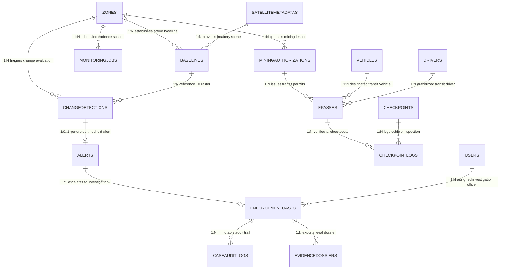

# MongoDB Database Schema Specification

**System:** Tamil Nadu Forest Monitoring System (TNFMS)
**Database Engine:** MongoDB 7+ (Local instance `mongodb://localhost:27017/tn_forest_monitoring`)
**Object Data Modeling:** Mongoose 8.x / TypeScript
**Verification Status:** **100% Live Database Verified** (All 23 collections connected, queried, and verified against MongoDB instance)

---

## 1. Executive Summary & Database Architecture

The Tamil Nadu Forest Monitoring System utilizes a document-oriented persistence architecture optimized for geospatial queries (`2dsphere` indexes), high-frequency satellite telemetry ingestion, audit trail immutability, and relational consistency between field checkpoints and forest zones. The live database currently contains **23 collections** supporting five operational domains:

1. **Geospatial & Zone Domain:** `zones`, `temporaryareas`, `baselines`, `hlsrepresentations`, `satellitemetadatas`
2. **Monitoring & Change Analytics Domain:** `monitoringjobs`, `changedetections`, `processedimageresults`, `incrementalmonitoringrecords`, `miningextractionestimates`
3. **Alerting & Investigation Domain:** `alerts`, `enforcementcases`, `caseauditlogs`, `evidencedossiers`, `reconciliationreports`
4. **Transport & Checkpoint Enforcement Domain:** `checkpoints`, `checkpointlogs`, `epasses`, `vehicles`, `drivers`, `transportcompanies`, `miningauthorizations`
5. **Security & Governance Domain:** `users`

---

## 2. Verified Collections Master Inventory

| # | MongoDB Collection | Mongoose Model | Source File | Live Docs | Primary Index / Key Constraints |
|---|---|---|---|---|---|
| 1 | `alerts` | `AlertModel` | [`Alert.ts`](file:///D:/tn-enforcement-system/tn-forest-monitoring/server/src/models/Alert.ts) | 1 | _id, alertId (Unique), zoneId, +12 more |
| 2 | `baselines` | `BaselineModel` | [`Baseline.ts`](file:///D:/tn-enforcement-system/tn-forest-monitoring/server/src/models/Baseline.ts) | 8 | _id, zoneId, satelliteMetadataId, +8 more |
| 3 | `caseauditlogs` | `CaseAuditLogModel` | [`CaseAuditLog.ts`](file:///D:/tn-enforcement-system/tn-forest-monitoring/server/src/models/CaseAuditLog.ts) | 50 | _id, auditId (Unique), caseId, +5 more |
| 4 | `changedetections` | `ChangeDetectionModel` | [`ChangeDetection.ts`](file:///D:/tn-enforcement-system/tn-forest-monitoring/server/src/models/ChangeDetection.ts) | 9 | _id, changeId (Unique), zoneId, +13 more |
| 5 | `checkpointlogs` | `CheckpointLogModel` | [`CheckpointLog.ts`](file:///D:/tn-enforcement-system/tn-forest-monitoring/server/src/models/CheckpointLog.ts) | 23 | _id, logId (Unique), checkpointId, +11 more |
| 6 | `checkpoints` | `CheckpointModel` | [`Checkpoint.ts`](file:///D:/tn-enforcement-system/tn-forest-monitoring/server/src/models/Checkpoint.ts) | 3 | _id, checkpointId (Unique), name, +3 more |
| 7 | `drivers` | `DriverModel` | [`Driver.ts`](file:///D:/tn-enforcement-system/tn-forest-monitoring/server/src/models/Driver.ts) | 2 | _id, driverId (Unique), licenseNumber (Unique), +2 more |
| 8 | `enforcementcases` | `EnforcementCaseModel` | [`EnforcementCase.ts`](file:///D:/tn-enforcement-system/tn-forest-monitoring/server/src/models/EnforcementCase.ts) | 13 | _id, caseId (Unique), reconciliationReportId, +10 more |
| 9 | `epasses` | `EPassModel` | [`EPass.ts`](file:///D:/tn-enforcement-system/tn-forest-monitoring/server/src/models/EPass.ts) | 8 | _id, passNumber (Unique), authorizationId, +7 more |
| 10 | `evidencedossiers` | `EvidenceDossierModel` | [`EvidenceDossier.ts`](file:///D:/tn-enforcement-system/tn-forest-monitoring/server/src/models/EvidenceDossier.ts) | 4 | _id, dossierId (Unique), caseId, +2 more |
| 11 | `hlsrepresentations` | `HLSRepresentationModel` | [`HLSRepresentation.ts`](file:///D:/tn-enforcement-system/tn-forest-monitoring/server/src/models/HLSRepresentation.ts) | 2 | _id, baselineId, sourceObservationId, +8 more |
| 12 | `incrementalmonitoringrecords` | `IncrementalMonitoringRecordModel` | [`IncrementalMonitoringRecord.ts`](file:///D:/tn-enforcement-system/tn-forest-monitoring/server/src/models/IncrementalMonitoringRecord.ts) | 13 | _id, jobId (Unique), areaId, +10 more |
| 13 | `miningauthorizations` | `MiningAuthorizationModel` | [`MiningAuthorization.ts`](file:///D:/tn-enforcement-system/tn-forest-monitoring/server/src/models/MiningAuthorization.ts) | 4 | _id, authorizationId (Unique), zoneId, +5 more |
| 14 | `miningextractionestimates` | `MiningExtractionEstimateModel` | [`MiningExtractionEstimate.ts`](file:///D:/tn-enforcement-system/tn-forest-monitoring/server/src/models/MiningExtractionEstimate.ts) | 2 | _id, estimateId (Unique), temporaryAreaId, +10 more |
| 15 | `monitoringjobs` | `MonitoringJobModel` | [`MonitoringJob.ts`](file:///D:/tn-enforcement-system/tn-forest-monitoring/server/src/models/MonitoringJob.ts) | 99 | _id, jobId (Unique), status, +3 more |
| 16 | `processedimageresults` | `ProcessedImageResultModel` | [`ProcessedImageResult.ts`](file:///D:/tn-enforcement-system/tn-forest-monitoring/server/src/models/ProcessedImageResult.ts) | 8 | _id, zoneId, satelliteMetadataId, +4 more |
| 17 | `reconciliationreports` | `ReconciliationReportModel` | [`ReconciliationReport.ts`](file:///D:/tn-enforcement-system/tn-forest-monitoring/server/src/models/ReconciliationReport.ts) | 6 | _id, reconciliationId (Unique), zoneId, +7 more |
| 18 | `satellitemetadatas` | `SatelliteMetadata` | [`SatelliteMetadata.ts`](file:///D:/tn-enforcement-system/tn-forest-monitoring/server/src/models/SatelliteMetadata.ts) | 13 | _id, imageId (Unique), acquisitionDate, +6 more |
| 19 | `temporaryareas` | `TemporaryAreaModel` | [`TemporaryArea.ts`](file:///D:/tn-enforcement-system/tn-forest-monitoring/server/src/models/TemporaryArea.ts) | 3 | _id, temporaryAreaId (Unique), startDate, +7 more |
| 20 | `transportcompanies` | `TransportCompanyModel` | [`TransportCompany.ts`](file:///D:/tn-enforcement-system/tn-forest-monitoring/server/src/models/TransportCompany.ts) | 1 | _id, companyId (Unique), registrationNumber (Unique), +1 more |
| 21 | `users` | `User` | [`User.ts`](file:///D:/tn-enforcement-system/tn-forest-monitoring/server/src/models/User.ts) | 11 | _id, employeeId (Unique), email (Unique), +1 more |
| 22 | `vehicles` | `VehicleModel` | [`Vehicle.ts`](file:///D:/tn-enforcement-system/tn-forest-monitoring/server/src/models/Vehicle.ts) | 3 | _id, vehicleId (Unique), registrationNumber (Unique), +2 more |
| 23 | `zones` | `Zone` | [`Zone.ts`](file:///D:/tn-enforcement-system/tn-forest-monitoring/server/src/models/Zone.ts) | 5 | _id, zoneId (Unique), name (Unique), +3 more |

---

## 3. Entity-Relationship Architecture Diagram

---

## 4. Comprehensive Collection Schema Definitions

### 4.Alerts — `alerts`
- **Mongoose Model:** `AlertModel`
- **Source File:** `server/src/models/Alert.ts`
- **Live Records in DB:** `1` document(s)
- **Operational Purpose:** Manages alerts entities

**Schema Fields & Constraints:**

| Field Name | Data Type | Constraints & Defaults | Data Source |
|---|---|---|---|
| `_id` | `ObjectId` | Primary Key, Auto-generated | Core DB |
| `action` | `String` | Required, Enum constrained | Mongoose Schema |
| `fromStatus` | `String` | Required, Enum constrained | Mongoose Schema |
| `toStatus` | `String` | Required, Enum constrained | Mongoose Schema |
| `performedBy` | `ObjectId` | Required, Ref: `User` | Mongoose Schema |
| `performedAt` | `Date` | Required | Mongoose Schema |
| `notes` | `String` | Optional | Mongoose Schema |
| `alertId` | `Observed Document Property` | Present in live documents | Live Document Observation |
| `zoneId` | `Observed Document Property` | Present in live documents | Live Document Observation |
| `changeDetectionId` | `Observed Document Property` | Present in live documents | Live Document Observation |
| `detectedAt` | `Observed Document Property` | Present in live documents | Live Document Observation |
| `affectedAreaPercentage` | `Observed Document Property` | Present in live documents | Live Document Observation |
| `highestThresholdCrossed` | `Observed Document Property` | Present in live documents | Live Document Observation |
| `thresholdsCrossed` | `Observed Document Property` | Present in live documents | Live Document Observation |
| `severity` | `Observed Document Property` | Present in live documents | Live Document Observation |
| `evidenceStrength` | `Observed Document Property` | Present in live documents | Live Document Observation |
| `calculationMode` | `Observed Document Property` | Present in live documents | Live Document Observation |
| `sensorType` | `Observed Document Property` | Present in live documents | Live Document Observation |
| `monitoringTrack` | `Observed Document Property` | Present in live documents | Live Document Observation |
| `evidenceSources` | `Observed Document Property` | Present in live documents | Live Document Observation |
| `categories` | `Observed Document Property` | Present in live documents | Live Document Observation |
| `explanation` | `Observed Document Property` | Present in live documents | Live Document Observation |
| `status` | `Observed Document Property` | Present in live documents | Live Document Observation |
| `auditHistory` | `Observed Document Property` | Present in live documents | Live Document Observation |
| `createdAt` | `Observed Document Property` | Present in live documents | Live Document Observation |
| `updatedAt` | `Observed Document Property` | Present in live documents | Live Document Observation |
| `createdAt` | `Date` | Timestamp (Auto-generated) | Mongoose Timestamps |
| `updatedAt` | `Date` | Timestamp (Auto-generated) | Mongoose Timestamps |

**Configured Database Indexes:**

- Index `_id_`: [`_id`: 1]
- Index `alertId_1`: [`alertId`: 1] (Unique)
- Index `zoneId_1`: [`zoneId`: 1]
- Index `changeDetectionId_1`: [`changeDetectionId`: 1]
- Index `detectedAt_1`: [`detectedAt`: 1]
- Index `severity_1`: [`severity`: 1]
- Index `sensorType_1`: [`sensorType`: 1]
- Index `status_1`: [`status`: 1]
- Index `zoneId_1_status_1`: [`zoneId`: 1, `status`: 1]
- Index `status_1_severity_1`: [`status`: 1, `severity`: 1]
- Index `detectedAt_-1`: [`detectedAt`: -1]
- Index `temporaryAreaId_1`: [`temporaryAreaId`: 1]
- Index `monitoringTrack_1`: [`monitoringTrack`: 1]
- Index `monitoringTrack_1_status_1`: [`monitoringTrack`: 1, `status`: 1]
- Index `assignedTo_1_status_1`: [`assignedTo`: 1, `status`: 1]

---

### 4.Baselines — `baselines`
- **Mongoose Model:** `BaselineModel`
- **Source File:** `server/src/models/Baseline.ts`
- **Live Records in DB:** `8` document(s)
- **Operational Purpose:** HLS (Harmonized Landsat Sentinel) representation reference.

**Schema Fields & Constraints:**

| Field Name | Data Type | Constraints & Defaults | Data Source |
|---|---|---|---|
| `_id` | `ObjectId` | Primary Key, Auto-generated | Core DB |
| `zoneId` | `ObjectId` | Required, Ref: `Zone` | Mongoose Schema |
| `satelliteMetadataId` | `ObjectId` | Required, Ref: `SatelliteMetadata` | Mongoose Schema |
| `imageId` | `String` | Optional | Mongoose Schema |
| `sensorType` | `String` | Required, Enum constrained | Mongoose Schema |
| `monitoringTrack` | `String` | Required, Default: MonitoringTrack.OPTICAL, Enum constrained | Mongoose Schema |
| `source` | `String` | Required, Enum constrained | Mongoose Schema |
| `acquisitionDate` | `Date` | Required | Mongoose Schema |
| `status` | `String` | Required, Default: BaselineStatus.CANDIDATE, Enum constrained | Mongoose Schema |
| `isActive` | `Boolean` | Required, Default: false | Mongoose Schema |
| `qualityScore` | `Number` | Required | Mongoose Schema |
| `cloudCover` | `Number` | Default: null | Mongoose Schema |
| `validPixelPercentage` | `Number` | Default: 100 | Mongoose Schema |
| `selectionReason` | `String` | Required | Mongoose Schema |
| `processingSummary` | `String` | Optional | Mongoose Schema |
| `validFrom` | `Date` | Optional | Mongoose Schema |
| `validUntil` | `Date` | Optional | Mongoose Schema |
| `createdBy` | `ObjectId` | Ref: `User` | Mongoose Schema |
| `hlsRepresentationId` | `ObjectId` | Ref: `HLSRepresentation` | Mongoose Schema |
| `geeExportTaskId` | `String` | Optional | Mongoose Schema |
| `driveFileId` | `String` | Optional | Mongoose Schema |
| `driveFileName` | `String` | Optional | Mongoose Schema |
| `driveFileSizeBytes` | `Number` | Optional | Mongoose Schema |
| `localRasterPath` | `String` | Optional | Mongoose Schema |
| `rasterValidated` | `Boolean` | Default: false | Mongoose Schema |
| `rasterWidth` | `Number` | Optional | Mongoose Schema |
| `rasterHeight` | `Number` | Optional | Mongoose Schema |
| `rasterCrs` | `String` | Optional | Mongoose Schema |
| `originalCrs` | `String` | Optional | Mongoose Schema |
| `areaCalculationCrs` | `String` | Optional | Mongoose Schema |
| `pixelAreaM2` | `Number` | Optional | Mongoose Schema |
| `rasterBandCount` | `Number` | Optional | Mongoose Schema |
| `spectralIndicesCalculated` | `Boolean` | Default: false | Mongoose Schema |
| `pipelineCompletedAt` | `Date` | Optional | Mongoose Schema |
| `failureReason` | `String` | Optional | Mongoose Schema |
| `errorStage` | `String` | Enum constrained | Mongoose Schema |
| `errorCode` | `String` | Optional | Mongoose Schema |
| `errorMessage` | `String` | Optional | Mongoose Schema |
| `errorCause` | `String` | Optional | Mongoose Schema |
| `failedAt` | `Date` | Optional | Mongoose Schema |
| `operationId` | `String` | Optional | Mongoose Schema |
| `retryCount` | `Number` | Optional | Mongoose Schema |
| `platform` | `String` | Optional | Mongoose Schema |
| `mode` | `String` | Optional | Mongoose Schema |
| `orbitDirection` | `String` | Enum constrained | Mongoose Schema |
| `absoluteOrbitNumber` | `Number` | Optional | Mongoose Schema |
| `relativeOrbitNumber` | `Number` | Optional | Mongoose Schema |
| `polarizations` | `Observed Document Property` | Present in live documents | Live Document Observation |
| `createdAt` | `Observed Document Property` | Present in live documents | Live Document Observation |
| `updatedAt` | `Observed Document Property` | Present in live documents | Live Document Observation |
| `createdAt` | `Date` | Timestamp (Auto-generated) | Mongoose Timestamps |
| `updatedAt` | `Date` | Timestamp (Auto-generated) | Mongoose Timestamps |

**Configured Database Indexes:**

- Index `_id_`: [`_id`: 1]
- Index `zoneId_1`: [`zoneId`: 1]
- Index `satelliteMetadataId_1`: [`satelliteMetadataId`: 1]
- Index `sensorType_1`: [`sensorType`: 1]
- Index `status_1`: [`status`: 1]
- Index `isActive_1`: [`isActive`: 1]
- Index `zoneId_1_sensorType_1_isActive_1`: [`zoneId`: 1, `sensorType`: 1, `isActive`: 1]
- Index `zoneId_1_sensorType_1_status_1`: [`zoneId`: 1, `sensorType`: 1, `status`: 1]
- Index `zoneId_1_acquisitionDate_-1`: [`zoneId`: 1, `acquisitionDate`: -1]
- Index `monitoringTrack_1`: [`monitoringTrack`: 1]
- Index `imageId_1`: [`imageId`: 1]

---

### 4.Caseauditlogs — `caseauditlogs`
- **Mongoose Model:** `CaseAuditLogModel`
- **Source File:** `server/src/models/CaseAuditLog.ts`
- **Live Records in DB:** `50` document(s)
- **Operational Purpose:** Manages caseauditlogs entities

**Schema Fields & Constraints:**

| Field Name | Data Type | Constraints & Defaults | Data Source |
|---|---|---|---|
| `_id` | `ObjectId` | Primary Key, Auto-generated | Core DB |
| `auditId` | `String` | Required, Unique | Mongoose Schema |
| `caseId` | `ObjectId` | Required, Ref: `EnforcementCase` | Mongoose Schema |
| `caseNumber` | `String` | Required | Mongoose Schema |
| `actorId` | `ObjectId` | Ref: `User` | Mongoose Schema |
| `actorName` | `String` | Required | Mongoose Schema |
| `actorRole` | `String` | Required | Mongoose Schema |
| `action` | `String` | Required, Enum constrained | Mongoose Schema |
| `previousStatus` | `String` | Enum constrained | Mongoose Schema |
| `newStatus` | `String` | Enum constrained | Mongoose Schema |
| `remarks` | `String` | Default: '' | Mongoose Schema |
| `changes` | `Mixed` | Optional | Mongoose Schema |
| `timestamp` | `Date` | Default: Date.now | Mongoose Schema |
| `createdAt` | `Date` | Timestamp (Auto-generated) | Mongoose Timestamps |
| `updatedAt` | `Date` | Timestamp (Auto-generated) | Mongoose Timestamps |

**Configured Database Indexes:**

- Index `_id_`: [`_id`: 1]
- Index `auditId_1`: [`auditId`: 1] (Unique)
- Index `caseId_1`: [`caseId`: 1]
- Index `caseNumber_1`: [`caseNumber`: 1]
- Index `actorId_1`: [`actorId`: 1]
- Index `action_1`: [`action`: 1]
- Index `timestamp_1`: [`timestamp`: 1]
- Index `caseId_1_timestamp_-1`: [`caseId`: 1, `timestamp`: -1]

---

### 4.Changedetections — `changedetections`
- **Mongoose Model:** `ChangeDetectionModel`
- **Source File:** `server/src/models/ChangeDetection.ts`
- **Live Records in DB:** `9` document(s)
- **Operational Purpose:** Manages changedetections entities

**Schema Fields & Constraints:**

| Field Name | Data Type | Constraints & Defaults | Data Source |
|---|---|---|---|
| `_id` | `ObjectId` | Primary Key, Auto-generated | Core DB |
| `magnitudeScore` | `Number` | Required | Mongoose Schema |
| `dataQualityScore` | `Number` | Required | Mongoose Schema |
| `temporalConsistencyScore` | `Number` | Required | Mongoose Schema |
| `crossSensorScore` | `Number` | Required | Mongoose Schema |
| `totalEvidenceScore` | `Number` | Required | Mongoose Schema |
| `explanation` | `String` | Required | Mongoose Schema |
| `changeId` | `Observed Document Property` | Present in live documents | Live Document Observation |
| `zoneId` | `Observed Document Property` | Present in live documents | Live Document Observation |
| `observationId` | `Observed Document Property` | Present in live documents | Live Document Observation |
| `baselineId` | `Observed Document Property` | Present in live documents | Live Document Observation |
| `sensorType` | `Observed Document Property` | Present in live documents | Live Document Observation |
| `monitoringTrack` | `Observed Document Property` | Present in live documents | Live Document Observation |
| `source` | `Observed Document Property` | Present in live documents | Live Document Observation |
| `detectedAt` | `Observed Document Property` | Present in live documents | Live Document Observation |
| `zoneArea` | `Observed Document Property` | Present in live documents | Live Document Observation |
| `changedArea` | `Observed Document Property` | Present in live documents | Live Document Observation |
| `affectedAreaPercentage` | `Observed Document Property` | Present in live documents | Live Document Observation |
| `calculationMode` | `Observed Document Property` | Present in live documents | Live Document Observation |
| `spatialSource` | `Observed Document Property` | Present in live documents | Live Document Observation |
| `comparisonMode` | `Observed Document Property` | Present in live documents | Live Document Observation |
| `changedGeometry` | `Observed Document Property` | Present in live documents | Live Document Observation |
| `threshold2Crossed` | `Observed Document Property` | Present in live documents | Live Document Observation |
| `threshold5Crossed` | `Observed Document Property` | Present in live documents | Live Document Observation |
| `threshold10Crossed` | `Observed Document Property` | Present in live documents | Live Document Observation |
| `highestThresholdCrossed` | `Observed Document Property` | Present in live documents | Live Document Observation |
| `severity` | `Observed Document Property` | Present in live documents | Live Document Observation |
| `evidenceStrength` | `Observed Document Property` | Present in live documents | Live Document Observation |
| `evidenceBreakdown` | `Observed Document Property` | Present in live documents | Live Document Observation |
| `categories` | `Observed Document Property` | Present in live documents | Live Document Observation |
| `changeIndicators` | `Observed Document Property` | Present in live documents | Live Document Observation |
| `crossSensorAgreement` | `Observed Document Property` | Present in live documents | Live Document Observation |
| `temporalConsistency` | `Observed Document Property` | Present in live documents | Live Document Observation |
| `alertGenerated` | `Observed Document Property` | Present in live documents | Live Document Observation |
| `createdAt` | `Observed Document Property` | Present in live documents | Live Document Observation |
| `updatedAt` | `Observed Document Property` | Present in live documents | Live Document Observation |
| `createdAt` | `Date` | Timestamp (Auto-generated) | Mongoose Timestamps |
| `updatedAt` | `Date` | Timestamp (Auto-generated) | Mongoose Timestamps |

**Configured Database Indexes:**

- Index `_id_`: [`_id`: 1]
- Index `changeId_1`: [`changeId`: 1] (Unique)
- Index `zoneId_1`: [`zoneId`: 1]
- Index `observationId_1`: [`observationId`: 1]
- Index `baselineId_1`: [`baselineId`: 1]
- Index `sensorType_1`: [`sensorType`: 1]
- Index `detectedAt_1`: [`detectedAt`: 1]
- Index `severity_1`: [`severity`: 1]
- Index `alertGenerated_1`: [`alertGenerated`: 1]
- Index `zoneId_1_detectedAt_-1`: [`zoneId`: 1, `detectedAt`: -1]
- Index `temporaryAreaId_1`: [`temporaryAreaId`: 1]
- Index `referenceObservationId_1`: [`referenceObservationId`: 1]
- Index `temporaryAreaId_1_detectedAt_-1`: [`temporaryAreaId`: 1, `detectedAt`: -1]
- Index `monitoringTrack_1`: [`monitoringTrack`: 1]
- Index `zoneId_1_observationId_1_baselineId_1_calculationMethod_1`: [`zoneId`: 1, `observationId`: 1, `baselineId`: 1, `calculationMethod`: 1] (Unique)
- Index `temporaryAreaId_1_observationId_1_referenceObservationId_1_calculationMethod_1`: [`temporaryAreaId`: 1, `observationId`: 1, `referenceObservationId`: 1, `calculationMethod`: 1] (Unique)

---

### 4.Checkpointlogs — `checkpointlogs`
- **Mongoose Model:** `CheckpointLogModel`
- **Source File:** `server/src/models/CheckpointLog.ts`
- **Live Records in DB:** `23` document(s)
- **Operational Purpose:** Manages checkpointlogs entities

**Schema Fields & Constraints:**

| Field Name | Data Type | Constraints & Defaults | Data Source |
|---|---|---|---|
| `_id` | `ObjectId` | Primary Key, Auto-generated | Core DB |
| `type` | `String` | Required, Default: 'Point', Enum constrained | Mongoose Schema |
| `coordinates` | `[Number]` | Required | Mongoose Schema |
| `logId` | `Observed Document Property` | Present in live documents | Live Document Observation |
| `checkpointId` | `Observed Document Property` | Present in live documents | Live Document Observation |
| `checkpointName` | `Observed Document Property` | Present in live documents | Live Document Observation |
| `epassId` | `Observed Document Property` | Present in live documents | Live Document Observation |
| `passNumber` | `Observed Document Property` | Present in live documents | Live Document Observation |
| `vehicleId` | `Observed Document Property` | Present in live documents | Live Document Observation |
| `vehicleRegistrationNumber` | `Observed Document Property` | Present in live documents | Live Document Observation |
| `driverId` | `Observed Document Property` | Present in live documents | Live Document Observation |
| `driverName` | `Observed Document Property` | Present in live documents | Live Document Observation |
| `driverLicenseNumber` | `Observed Document Property` | Present in live documents | Live Document Observation |
| `authorizationId` | `Observed Document Property` | Present in live documents | Live Document Observation |
| `permitNumber` | `Observed Document Property` | Present in live documents | Live Document Observation |
| `mineralType` | `Observed Document Property` | Present in live documents | Live Document Observation |
| `authorizedQuantityTonnes` | `Observed Document Property` | Present in live documents | Live Document Observation |
| `declaredQuantityTonnes` | `Observed Document Property` | Present in live documents | Live Document Observation |
| `verificationTimestamp` | `Observed Document Property` | Present in live documents | Live Document Observation |
| `verificationResult` | `Observed Document Property` | Present in live documents | Live Document Observation |
| `rejectionReasons` | `Observed Document Property` | Present in live documents | Live Document Observation |
| `signatureVerified` | `Observed Document Property` | Present in live documents | Live Document Observation |
| `hashVerified` | `Observed Document Property` | Present in live documents | Live Document Observation |
| `locationStatus` | `Observed Document Property` | Present in live documents | Live Document Observation |
| `scannedCoordinates` | `Observed Document Property` | Present in live documents | Live Document Observation |
| `distanceFromCheckpointMeters` | `Observed Document Property` | Present in live documents | Live Document Observation |
| `createdAt` | `Observed Document Property` | Present in live documents | Live Document Observation |
| `updatedAt` | `Observed Document Property` | Present in live documents | Live Document Observation |
| `createdAt` | `Date` | Timestamp (Auto-generated) | Mongoose Timestamps |
| `updatedAt` | `Date` | Timestamp (Auto-generated) | Mongoose Timestamps |

**Configured Database Indexes:**

- Index `_id_`: [`_id`: 1]
- Index `logId_1`: [`logId`: 1] (Unique)
- Index `checkpointId_1`: [`checkpointId`: 1]
- Index `epassId_1`: [`epassId`: 1]
- Index `passNumber_1`: [`passNumber`: 1]
- Index `vehicleId_1`: [`vehicleId`: 1]
- Index `driverId_1`: [`driverId`: 1]
- Index `verificationTimestamp_1`: [`verificationTimestamp`: 1]
- Index `verificationResult_1`: [`verificationResult`: 1]
- Index `verifiedBy_1`: [`verifiedBy`: 1]
- Index `verificationTimestamp_-1`: [`verificationTimestamp`: -1]
- Index `checkpointId_1_verificationTimestamp_-1`: [`checkpointId`: 1, `verificationTimestamp`: -1]
- Index `passNumber_1_verificationTimestamp_-1`: [`passNumber`: 1, `verificationTimestamp`: -1]
- Index `scannedCoordinates_2dsphere`: [`scannedCoordinates`: 2dsphere] (Geospatial 2dsphere)

---

### 4.Checkpoints — `checkpoints`
- **Mongoose Model:** `CheckpointModel`
- **Source File:** `server/src/models/Checkpoint.ts`
- **Live Records in DB:** `3` document(s)
- **Operational Purpose:** Manages checkpoints entities

**Schema Fields & Constraints:**

| Field Name | Data Type | Constraints & Defaults | Data Source |
|---|---|---|---|
| `_id` | `ObjectId` | Primary Key, Auto-generated | Core DB |
| `type` | `String` | Required, Default: 'Point', Enum constrained | Mongoose Schema |
| `coordinates` | `[Number]` | Required | Mongoose Schema |
| `checkpointId` | `Observed Document Property` | Present in live documents | Live Document Observation |
| `name` | `Observed Document Property` | Present in live documents | Live Document Observation |
| `district` | `Observed Document Property` | Present in live documents | Live Document Observation |
| `location` | `Observed Document Property` | Present in live documents | Live Document Observation |
| `geofenceRadiusMeters` | `Observed Document Property` | Present in live documents | Live Document Observation |
| `status` | `Observed Document Property` | Present in live documents | Live Document Observation |
| `authorizedUserIds` | `Observed Document Property` | Present in live documents | Live Document Observation |
| `operatingHours` | `Observed Document Property` | Present in live documents | Live Document Observation |
| `createdAt` | `Observed Document Property` | Present in live documents | Live Document Observation |
| `updatedAt` | `Observed Document Property` | Present in live documents | Live Document Observation |
| `createdAt` | `Date` | Timestamp (Auto-generated) | Mongoose Timestamps |
| `updatedAt` | `Date` | Timestamp (Auto-generated) | Mongoose Timestamps |

**Configured Database Indexes:**

- Index `_id_`: [`_id`: 1]
- Index `checkpointId_1`: [`checkpointId`: 1] (Unique)
- Index `name_1`: [`name`: 1]
- Index `district_1`: [`district`: 1]
- Index `status_1`: [`status`: 1]
- Index `location_2dsphere`: [`location`: 2dsphere] (Geospatial 2dsphere)

---

### 4.Drivers — `drivers`
- **Mongoose Model:** `DriverModel`
- **Source File:** `server/src/models/Driver.ts`
- **Live Records in DB:** `2` document(s)
- **Operational Purpose:** Manages drivers entities

**Schema Fields & Constraints:**

| Field Name | Data Type | Constraints & Defaults | Data Source |
|---|---|---|---|
| `_id` | `ObjectId` | Primary Key, Auto-generated | Core DB |
| `driverId` | `String` | Required, Unique | Mongoose Schema |
| `licenseNumber` | `String` | Required, Unique | Mongoose Schema |
| `name` | `String` | Required | Mongoose Schema |
| `phone` | `String` | Required | Mongoose Schema |
| `verificationStatus` | `String` | Default: DriverVerificationStatus.VERIFIED, Enum constrained | Mongoose Schema |
| `transportCompanyId` | `ObjectId` | Ref: `TransportCompany` | Mongoose Schema |
| `createdBy` | `ObjectId` | Ref: `User` | Mongoose Schema |
| `createdAt` | `Observed Document Property` | Present in live documents | Live Document Observation |
| `updatedAt` | `Observed Document Property` | Present in live documents | Live Document Observation |
| `createdAt` | `Date` | Timestamp (Auto-generated) | Mongoose Timestamps |
| `updatedAt` | `Date` | Timestamp (Auto-generated) | Mongoose Timestamps |

**Configured Database Indexes:**

- Index `_id_`: [`_id`: 1]
- Index `driverId_1`: [`driverId`: 1] (Unique)
- Index `licenseNumber_1`: [`licenseNumber`: 1] (Unique)
- Index `verificationStatus_1`: [`verificationStatus`: 1]
- Index `transportCompanyId_1`: [`transportCompanyId`: 1]

---

### 4.Enforcementcases — `enforcementcases`
- **Mongoose Model:** `EnforcementCaseModel`
- **Source File:** `server/src/models/EnforcementCase.ts`
- **Live Records in DB:** `13` document(s)
- **Operational Purpose:** Manages enforcementcases entities

**Schema Fields & Constraints:**

| Field Name | Data Type | Constraints & Defaults | Data Source |
|---|---|---|---|
| `_id` | `ObjectId` | Primary Key, Auto-generated | Core DB |
| `verifiedAt` | `Date` | Optional | Mongoose Schema |
| `verifiedBy` | `ObjectId` | Ref: `User` | Mongoose Schema |
| `locationCoordinates` | `[Number]` | Optional | Mongoose Schema |
| `siteObservations` | `String` | Optional | Mongoose Schema |
| `photoUrls` | `[String]` | Default: [] | Mongoose Schema |
| `droneSurveyConducted` | `Boolean` | Default: false | Mongoose Schema |
| `groundDisturbanceConfirmed` | `Boolean` | Default: false | Mongoose Schema |
| `notes` | `String` | Optional | Mongoose Schema |
| `caseId` | `Observed Document Property` | Present in live documents | Live Document Observation |
| `reconciliationReportId` | `Observed Document Property` | Present in live documents | Live Document Observation |
| `reconciliationReportNumber` | `Observed Document Property` | Present in live documents | Live Document Observation |
| `zoneId` | `Observed Document Property` | Present in live documents | Live Document Observation |
| `zoneName` | `Observed Document Property` | Present in live documents | Live Document Observation |
| `severity` | `Observed Document Property` | Present in live documents | Live Document Observation |
| `caseType` | `Observed Document Property` | Present in live documents | Live Document Observation |
| `title` | `Observed Document Property` | Present in live documents | Live Document Observation |
| `description` | `Observed Document Property` | Present in live documents | Live Document Observation |
| `status` | `Observed Document Property` | Present in live documents | Live Document Observation |
| `assignedOfficerId` | `Observed Document Property` | Present in live documents | Live Document Observation |
| `assignedOfficerName` | `Observed Document Property` | Present in live documents | Live Document Observation |
| `assignedAt` | `Observed Document Property` | Present in live documents | Live Document Observation |
| `investigationFindings` | `Observed Document Property` | Present in live documents | Live Document Observation |
| `fieldVerification` | `Observed Document Property` | Present in live documents | Live Document Observation |
| `enforcementAction` | `Observed Document Property` | Present in live documents | Live Document Observation |
| `createdBy` | `Observed Document Property` | Present in live documents | Live Document Observation |
| `createdAt` | `Observed Document Property` | Present in live documents | Live Document Observation |
| `updatedAt` | `Observed Document Property` | Present in live documents | Live Document Observation |
| `createdAt` | `Date` | Timestamp (Auto-generated) | Mongoose Timestamps |
| `updatedAt` | `Date` | Timestamp (Auto-generated) | Mongoose Timestamps |

**Configured Database Indexes:**

- Index `_id_`: [`_id`: 1]
- Index `caseId_1`: [`caseId`: 1] (Unique)
- Index `reconciliationReportId_1`: [`reconciliationReportId`: 1]
- Index `zoneId_1`: [`zoneId`: 1]
- Index `authorizationId_1`: [`authorizationId`: 1]
- Index `severity_1`: [`severity`: 1]
- Index `caseType_1`: [`caseType`: 1]
- Index `status_1`: [`status`: 1]
- Index `assignedOfficerId_1`: [`assignedOfficerId`: 1]
- Index `status_1_createdAt_-1`: [`status`: 1, `createdAt`: -1]
- Index `severity_1_createdAt_-1`: [`severity`: 1, `createdAt`: -1]
- Index `zoneId_1_status_1`: [`zoneId`: 1, `status`: 1]
- Index `assignedOfficerId_1_status_1`: [`assignedOfficerId`: 1, `status`: 1]

---

### 4.Epasses — `epasses`
- **Mongoose Model:** `EPassModel`
- **Source File:** `server/src/models/EPass.ts`
- **Live Records in DB:** `8` document(s)
- **Operational Purpose:** Manages epasses entities

**Schema Fields & Constraints:**

| Field Name | Data Type | Constraints & Defaults | Data Source |
|---|---|---|---|
| `_id` | `ObjectId` | Primary Key, Auto-generated | Core DB |
| `passNumber` | `String` | Required, Unique | Mongoose Schema |
| `authorizationId` | `ObjectId` | Required, Ref: `MiningAuthorization` | Mongoose Schema |
| `vehicleId` | `ObjectId` | Required, Ref: `Vehicle` | Mongoose Schema |
| `driverId` | `ObjectId` | Required, Ref: `Driver` | Mongoose Schema |
| `mineralType` | `String` | Required | Mongoose Schema |
| `netWeightTonnes` | `Number` | Required | Mongoose Schema |
| `sourceLocation` | `String` | Required | Mongoose Schema |
| `destinationCheckpoint` | `String` | Required | Mongoose Schema |
| `validFrom` | `Date` | Required | Mongoose Schema |
| `validUntil` | `Date` | Required | Mongoose Schema |
| `qrPayload` | `String` | Required | Mongoose Schema |
| `qrCodeHash` | `String` | Required | Mongoose Schema |
| `digitalSignature` | `String` | Required | Mongoose Schema |
| `status` | `String` | Default: EPassStatus.ACTIVE, Enum constrained | Mongoose Schema |
| `dispatchTimestamp` | `Date` | Optional | Mongoose Schema |
| `usedTimestamp` | `Date` | Optional | Mongoose Schema |
| `cancellationReason` | `String` | Optional | Mongoose Schema |
| `createdBy` | `ObjectId` | Ref: `User` | Mongoose Schema |
| `createdAt` | `Observed Document Property` | Present in live documents | Live Document Observation |
| `updatedAt` | `Observed Document Property` | Present in live documents | Live Document Observation |
| `createdAt` | `Date` | Timestamp (Auto-generated) | Mongoose Timestamps |
| `updatedAt` | `Date` | Timestamp (Auto-generated) | Mongoose Timestamps |

**Configured Database Indexes:**

- Index `_id_`: [`_id`: 1]
- Index `passNumber_1`: [`passNumber`: 1] (Unique)
- Index `authorizationId_1`: [`authorizationId`: 1]
- Index `vehicleId_1`: [`vehicleId`: 1]
- Index `driverId_1`: [`driverId`: 1]
- Index `status_1`: [`status`: 1]
- Index `status_1_validUntil_1`: [`status`: 1, `validUntil`: 1]
- Index `authorizationId_1_status_1`: [`authorizationId`: 1, `status`: 1]
- Index `vehicleId_1_status_1`: [`vehicleId`: 1, `status`: 1]
- Index `driverId_1_status_1`: [`driverId`: 1, `status`: 1]

---

### 4.Evidencedossiers — `evidencedossiers`
- **Mongoose Model:** `EvidenceDossierModel`
- **Source File:** `server/src/models/EvidenceDossier.ts`
- **Live Records in DB:** `4` document(s)
- **Operational Purpose:** Manages evidencedossiers entities

**Schema Fields & Constraints:**

| Field Name | Data Type | Constraints & Defaults | Data Source |
|---|---|---|---|
| `_id` | `ObjectId` | Primary Key, Auto-generated | Core DB |
| `dossierId` | `String` | Required, Unique | Mongoose Schema |
| `caseId` | `ObjectId` | Required, Ref: `EnforcementCase` | Mongoose Schema |
| `caseNumber` | `String` | Required | Mongoose Schema |
| `dossierVersion` | `Number` | Required, Default: 1 | Mongoose Schema |
| `dossierHash` | `String` | Required | Mongoose Schema |
| `hashAlgorithm` | `String` | Required, Default: 'SHA-256' | Mongoose Schema |
| `isSealed` | `Boolean` | Required, Default: true | Mongoose Schema |
| `sealedAt` | `Date` | Required, Default: Date.now | Mongoose Schema |
| `sealedBy` | `ObjectId` | Ref: `User` | Mongoose Schema |
| `sealedByName` | `String` | Optional | Mongoose Schema |
| `canonicalPayload` | `String` | Required | Mongoose Schema |
| `dossierData` | `Mixed` | Required | Mongoose Schema |
| `createdAt` | `Observed Document Property` | Present in live documents | Live Document Observation |
| `updatedAt` | `Observed Document Property` | Present in live documents | Live Document Observation |
| `createdAt` | `Date` | Timestamp (Auto-generated) | Mongoose Timestamps |
| `updatedAt` | `Date` | Timestamp (Auto-generated) | Mongoose Timestamps |

**Configured Database Indexes:**

- Index `_id_`: [`_id`: 1]
- Index `dossierId_1`: [`dossierId`: 1] (Unique)
- Index `caseId_1`: [`caseId`: 1]
- Index `caseNumber_1`: [`caseNumber`: 1]
- Index `caseId_1_dossierVersion_-1`: [`caseId`: 1, `dossierVersion`: -1]

---

### 4.Hlsrepresentations — `hlsrepresentations`
- **Mongoose Model:** `HLSRepresentationModel`
- **Source File:** `server/src/models/HLSRepresentation.ts`
- **Live Records in DB:** `2` document(s)
- **Operational Purpose:** HLSRepresentation — Mongoose Model

**Schema Fields & Constraints:**

| Field Name | Data Type | Constraints & Defaults | Data Source |
|---|---|---|---|
| `_id` | `ObjectId` | Primary Key, Auto-generated | Core DB |
| `baselineId` | `ObjectId` | Ref: `Baseline` | Mongoose Schema |
| `isObservationOnly` | `Boolean` | Default: false | Mongoose Schema |
| `observationId` | `ObjectId` | Ref: `SatelliteMetadata` | Mongoose Schema |
| `sourceObservationId` | `String` | Required | Mongoose Schema |
| `satelliteMetadataId` | `ObjectId` | Required, Ref: `SatelliteMetadata` | Mongoose Schema |
| `sourceSatelliteSource` | `String` | Required, Enum constrained | Mongoose Schema |
| `sourceSensorType` | `String` | Required, Enum constrained | Mongoose Schema |
| `sourcePlatform` | `String` | Optional | Mongoose Schema |
| `sourceAcquisitionDate` | `Date` | Required | Mongoose Schema |
| `hlsProduct` | `String` | Required, Enum constrained | Mongoose Schema |
| `hlsVersion` | `String` | Required, Default: HLSVersion.V2_0, Enum constrained | Mongoose Schema |
| `processingVersion` | `String` | Required, Default: '1.0.0' | Mongoose Schema |
| `hlsMode` | `String` | Enum constrained | Mongoose Schema |
| `bandpassVersion` | `String` | Optional | Mongoose Schema |
| `brdfVersion` | `String` | Optional | Mongoose Schema |
| `sourceRasterHash` | `String` | Optional | Mongoose Schema |
| `status` | `String` | Required, Default: HLSRepresentationStatus.NOT_CREATED, Enum constrained | Mongoose Schema |
| `geeCollectionId` | `String` | Optional | Mongoose Schema |
| `geeImageId` | `String` | Optional | Mongoose Schema |
| `geeExportTaskId` | `String` | Optional | Mongoose Schema |
| `driveFileId` | `String` | Optional | Mongoose Schema |
| `driveFileName` | `String` | Optional | Mongoose Schema |
| `driveFileSizeBytes` | `Number` | Optional | Mongoose Schema |
| `localRasterPath` | `String` | Optional | Mongoose Schema |
| `rasterValidated` | `Boolean` | Optional | Mongoose Schema |
| `rasterBandCount` | `Number` | Optional | Mongoose Schema |
| `rasterWidth` | `Number` | Optional | Mongoose Schema |
| `rasterHeight` | `Number` | Optional | Mongoose Schema |
| `rasterCrs` | `String` | Optional | Mongoose Schema |
| `originalCrs` | `String` | Optional | Mongoose Schema |
| `rasterResolutionMeters` | `Number` | Optional | Mongoose Schema |
| `pixelAreaM2` | `Number` | Optional | Mongoose Schema |
| `validPixelCount` | `Number` | Optional | Mongoose Schema |
| `fileHash` | `String` | Optional | Mongoose Schema |
| `completedAt` | `Date` | Optional | Mongoose Schema |
| `errorStage` | `String` | Enum constrained | Mongoose Schema |
| `errorCode` | `String` | Optional | Mongoose Schema |
| `errorMessage` | `String` | Optional | Mongoose Schema |
| `errorCause` | `String` | Optional | Mongoose Schema |
| `failedAt` | `Date` | Optional | Mongoose Schema |
| `failureReason` | `String` | Optional | Mongoose Schema |
| `createdAt` | `Observed Document Property` | Present in live documents | Live Document Observation |
| `updatedAt` | `Observed Document Property` | Present in live documents | Live Document Observation |
| `createdAt` | `Date` | Timestamp (Auto-generated) | Mongoose Timestamps |
| `updatedAt` | `Date` | Timestamp (Auto-generated) | Mongoose Timestamps |

**Configured Database Indexes:**

- Index `_id_`: [`_id`: 1]
- Index `baselineId_1`: [`baselineId`: 1]
- Index `sourceObservationId_1`: [`sourceObservationId`: 1]
- Index `satelliteMetadataId_1`: [`satelliteMetadataId`: 1]
- Index `sourceAcquisitionDate_1`: [`sourceAcquisitionDate`: 1]
- Index `status_1`: [`status`: 1]
- Index `baselineId_1_hlsProduct_1_hlsVersion_1`: [`baselineId`: 1, `hlsProduct`: 1, `hlsVersion`: 1]
- Index `baselineId_1_sourceObservationId_1_hlsProduct_1_hlsVersion_1_processingVersion_1`: [`baselineId`: 1, `sourceObservationId`: 1, `hlsProduct`: 1, `hlsVersion`: 1, `processingVersion`: 1] (Unique)
- Index `sourceAcquisitionDate_-1`: [`sourceAcquisitionDate`: -1]
- Index `isObservationOnly_1`: [`isObservationOnly`: 1]
- Index `observationId_1`: [`observationId`: 1]

---

### 4.Incrementalmonitoringrecords — `incrementalmonitoringrecords`
- **Mongoose Model:** `IncrementalMonitoringRecordModel`
- **Source File:** `server/src/models/IncrementalMonitoringRecord.ts`
- **Live Records in DB:** `13` document(s)
- **Operational Purpose:** Manages incrementalmonitoringrecords entities

**Schema Fields & Constraints:**

| Field Name | Data Type | Constraints & Defaults | Data Source |
|---|---|---|---|
| `_id` | `ObjectId` | Primary Key, Auto-generated | Core DB |
| `jobId` | `String` | Required, Unique | Mongoose Schema |
| `areaId` | `String` | Required | Mongoose Schema |
| `areaType` | `String` | Required, Enum constrained | Mongoose Schema |
| `areaName` | `String` | Required | Mongoose Schema |
| `targetObservationId` | `String` | Optional | Mongoose Schema |
| `satelliteMetadataId` | `ObjectId` | Ref: `SatelliteMetadata` | Mongoose Schema |
| `sensorType` | `String` | Required, Enum constrained | Mongoose Schema |
| `source` | `String` | Required, Enum constrained | Mongoose Schema |
| `lifecycleState` | `String` | Required, Default: IncrementalLifecycleState.DISCOVERED, Enum constrained | Mongoose Schema |
| `acquisitionDate` | `Date` | Optional | Mongoose Schema |
| `startedAt` | `Date` | Optional | Mongoose Schema |
| `completedAt` | `Date` | Optional | Mongoose Schema |
| `durationMs` | `Number` | Optional | Mongoose Schema |
| `errorCode` | `String` | Optional | Mongoose Schema |
| `errorMessage` | `String` | Optional | Mongoose Schema |
| `retryCount` | `Number` | Default: 0 | Mongoose Schema |
| `maxRetries` | `Number` | Default: 3 | Mongoose Schema |
| `nextRetryAt` | `Date` | Optional | Mongoose Schema |
| `isPermanentFailure` | `Boolean` | Default: false | Mongoose Schema |
| `results` | `ObjectId` | Ref: `ProcessedImageResult` | Mongoose Schema |
| `changeDetectionId` | `ObjectId` | Ref: `ChangeDetection` | Mongoose Schema |
| `alertId` | `ObjectId` | Ref: `Alert` | Mongoose Schema |
| `affectedAreaPercentage` | `Number` | Optional | Mongoose Schema |
| `severity` | `String` | Optional | Mongoose Schema |
| `cloudCover` | `Number` | Optional | Mongoose Schema |
| `fallbackTriggered` | `Boolean` | Optional | Mongoose Schema |
| `logs` | `Observed Document Property` | Present in live documents | Live Document Observation |
| `createdAt` | `Observed Document Property` | Present in live documents | Live Document Observation |
| `updatedAt` | `Observed Document Property` | Present in live documents | Live Document Observation |
| `createdAt` | `Date` | Timestamp (Auto-generated) | Mongoose Timestamps |
| `updatedAt` | `Date` | Timestamp (Auto-generated) | Mongoose Timestamps |

**Configured Database Indexes:**

- Index `_id_`: [`_id`: 1]
- Index `jobId_1`: [`jobId`: 1] (Unique)
- Index `areaId_1`: [`areaId`: 1]
- Index `areaType_1`: [`areaType`: 1]
- Index `targetObservationId_1`: [`targetObservationId`: 1]
- Index `lifecycleState_1`: [`lifecycleState`: 1]
- Index `acquisitionDate_1`: [`acquisitionDate`: 1]
- Index `areaId_1_targetObservationId_1`: [`areaId`: 1, `targetObservationId`: 1]
- Index `areaId_1_lifecycleState_1`: [`areaId`: 1, `lifecycleState`: 1]
- Index `createdAt_-1`: [`createdAt`: -1]
- Index `nextRetryAt_1`: [`nextRetryAt`: 1]
- Index `lifecycleState_1_updatedAt_1`: [`lifecycleState`: 1, `updatedAt`: 1]
- Index `lifecycleState_1_nextRetryAt_1`: [`lifecycleState`: 1, `nextRetryAt`: 1]

---

### 4.Miningauthorizations — `miningauthorizations`
- **Mongoose Model:** `MiningAuthorizationModel`
- **Source File:** `server/src/models/MiningAuthorization.ts`
- **Live Records in DB:** `4` document(s)
- **Operational Purpose:** Manages miningauthorizations entities

**Schema Fields & Constraints:**

| Field Name | Data Type | Constraints & Defaults | Data Source |
|---|---|---|---|
| `_id` | `ObjectId` | Primary Key, Auto-generated | Core DB |
| `authorizationId` | `String` | Required, Unique | Mongoose Schema |
| `zoneId` | `ObjectId` | Ref: `Zone` | Mongoose Schema |
| `temporaryAreaId` | `ObjectId` | Ref: `TemporaryArea` | Mongoose Schema |
| `permitNumber` | `String` | Required, Unique | Mongoose Schema |
| `lesseeName` | `String` | Required | Mongoose Schema |
| `mineralType` | `String` | Required | Mongoose Schema |
| `permittedVolume` | `Number` | Optional | Mongoose Schema |
| `permittedWeightTonnes` | `Number` | Required | Mongoose Schema |
| `validFrom` | `Date` | Required | Mongoose Schema |
| `validUntil` | `Date` | Required | Mongoose Schema |
| `status` | `String` | Default: MiningAuthorizationStatus.ACTIVE, Enum constrained | Mongoose Schema |
| `remainingQuota` | `Number` | Required | Mongoose Schema |
| `createdBy` | `ObjectId` | Required, Ref: `User` | Mongoose Schema |
| `createdAt` | `Observed Document Property` | Present in live documents | Live Document Observation |
| `updatedAt` | `Observed Document Property` | Present in live documents | Live Document Observation |
| `createdAt` | `Date` | Timestamp (Auto-generated) | Mongoose Timestamps |
| `updatedAt` | `Date` | Timestamp (Auto-generated) | Mongoose Timestamps |

**Configured Database Indexes:**

- Index `_id_`: [`_id`: 1]
- Index `authorizationId_1`: [`authorizationId`: 1] (Unique)
- Index `zoneId_1`: [`zoneId`: 1]
- Index `temporaryAreaId_1`: [`temporaryAreaId`: 1]
- Index `permitNumber_1`: [`permitNumber`: 1] (Unique)
- Index `status_1`: [`status`: 1]
- Index `status_1_validUntil_1`: [`status`: 1, `validUntil`: 1]
- Index `remainingQuota_1`: [`remainingQuota`: 1]

---

### 4.Miningextractionestimates — `miningextractionestimates`
- **Mongoose Model:** `MiningExtractionEstimateModel`
- **Source File:** `server/src/models/MiningExtractionEstimate.ts`
- **Live Records in DB:** `2` document(s)
- **Operational Purpose:** Manages miningextractionestimates entities

**Schema Fields & Constraints:**

| Field Name | Data Type | Constraints & Defaults | Data Source |
|---|---|---|---|
| `_id` | `ObjectId` | Primary Key, Auto-generated | Core DB |
| `estimateId` | `String` | Required, Unique | Mongoose Schema |
| `areaType` | `String` | Required, Default: MarkedAreaType.TEMPORARY, Enum constrained | Mongoose Schema |
| `markedAreaId` | `String` | Required | Mongoose Schema |
| `temporaryAreaId` | `String` | Optional | Mongoose Schema |
| `zoneId` | `ObjectId` | Ref: `Zone` | Mongoose Schema |
| `changeDetectionId` | `ObjectId` | Ref: `ChangeDetection` | Mongoose Schema |
| `observationId` | `ObjectId` | Required, Ref: `SatelliteMetadata` | Mongoose Schema |
| `observationDate` | `Date` | Required | Mongoose Schema |
| `changedAreaSquareMeters` | `Number` | Required | Mongoose Schema |
| `changedAreaHectares` | `Number` | Required | Mongoose Schema |
| `percentageOfTemporaryArea` | `Number` | Required | Mongoose Schema |
| `miningClassification` | `String` | Required, Enum constrained | Mongoose Schema |
| `estimatedDepthMeters` | `Number` | Optional | Mongoose Schema |
| `estimatedVolumeCubicMeters` | `Number` | Optional | Mongoose Schema |
| `volumeUnit` | `String` | Required, Default: 'CUBIC_METERS' | Mongoose Schema |
| `isVolumeAvailable` | `Boolean` | Required, Default: false | Mongoose Schema |
| `volumeUnavailableReason` | `String` | Optional | Mongoose Schema |
| `estimationMethod` | `String` | Required, Default: 'UNAVAILABLE' | Mongoose Schema |
| `estimationConfidence` | `Number` | Required | Mongoose Schema |
| `disclaimer` | `String` | Required, Default: 'Satellite-derived approximate estimate. Environmental monitoring and decision-support only; not a certified mining survey.' | Mongoose Schema |
| `createdAt` | `Observed Document Property` | Present in live documents | Live Document Observation |
| `updatedAt` | `Observed Document Property` | Present in live documents | Live Document Observation |
| `createdAt` | `Date` | Timestamp (Auto-generated) | Mongoose Timestamps |
| `updatedAt` | `Date` | Timestamp (Auto-generated) | Mongoose Timestamps |

**Configured Database Indexes:**

- Index `_id_`: [`_id`: 1]
- Index `estimateId_1`: [`estimateId`: 1] (Unique)
- Index `temporaryAreaId_1`: [`temporaryAreaId`: 1]
- Index `changeDetectionId_1`: [`changeDetectionId`: 1]
- Index `observationId_1`: [`observationId`: 1]
- Index `observationDate_1`: [`observationDate`: 1]
- Index `miningClassification_1`: [`miningClassification`: 1]
- Index `temporaryAreaId_1_observationDate_1`: [`temporaryAreaId`: 1, `observationDate`: 1]
- Index `areaType_1`: [`areaType`: 1]
- Index `markedAreaId_1`: [`markedAreaId`: 1]
- Index `zoneId_1`: [`zoneId`: 1]
- Index `markedAreaId_1_observationDate_1`: [`markedAreaId`: 1, `observationDate`: 1]
- Index `zoneId_1_observationDate_1`: [`zoneId`: 1, `observationDate`: 1]

---

### 4.Monitoringjobs — `monitoringjobs`
- **Mongoose Model:** `MonitoringJobModel`
- **Source File:** `server/src/models/MonitoringJob.ts`
- **Live Records in DB:** `99` document(s)
- **Operational Purpose:** Manages monitoringjobs entities

**Schema Fields & Constraints:**

| Field Name | Data Type | Constraints & Defaults | Data Source |
|---|---|---|---|
| `_id` | `ObjectId` | Primary Key, Auto-generated | Core DB |
| `jobId` | `String` | Required, Unique | Mongoose Schema |
| `type` | `String` | Required, Enum constrained | Mongoose Schema |
| `zoneId` | `ObjectId` | Ref: `Zone` | Mongoose Schema |
| `satelliteMetadataId` | `ObjectId` | Ref: `SatelliteMetadata` | Mongoose Schema |
| `sensorType` | `String` | Enum constrained | Mongoose Schema |
| `source` | `String` | Enum constrained | Mongoose Schema |
| `status` | `String` | Required, Default: MonitoringJobStatus.PENDING, Enum constrained | Mongoose Schema |
| `retryCount` | `Number` | Default: 0 | Mongoose Schema |
| `maxRetries` | `Number` | Default: 3 | Mongoose Schema |
| `scheduledAt` | `Date` | Required | Mongoose Schema |
| `startedAt` | `Date` | Optional | Mongoose Schema |
| `completedAt` | `Date` | Optional | Mongoose Schema |
| `errorMessage` | `String` | Optional | Mongoose Schema |
| `lockedByWorkerId` | `String` | Optional | Mongoose Schema |
| `heartbeatAt` | `Date` | Optional | Mongoose Schema |
| `changeDetectionId` | `ObjectId` | Ref: `ChangeDetection` | Mongoose Schema |
| `acquisition` | `String` | Optional | Mongoose Schema |
| `satellite` | `String` | Optional | Mongoose Schema |
| `sensor` | `String` | Optional | Mongoose Schema |
| `collection` | `String` | Optional | Mongoose Schema |
| `imageId` | `String` | Optional | Mongoose Schema |
| `acquisitionDate` | `Date` | Optional | Mongoose Schema |
| `cloudCover` | `Number` | Optional | Mongoose Schema |
| `nativeResolution` | `Number` | Optional | Mongoose Schema |
| `export` | `String` | Optional | Mongoose Schema |
| `geeTaskState` | `String` | Optional | Mongoose Schema |
| `driveFileId` | `String` | Optional | Mongoose Schema |
| `driveFileName` | `String` | Optional | Mongoose Schema |
| `driveFolderId` | `String` | Optional | Mongoose Schema |
| `exportedAt` | `Date` | Optional | Mongoose Schema |
| `downloadedAt` | `Date` | Optional | Mongoose Schema |
| `processing` | `String` | Optional | Mongoose Schema |
| `nativeResolution` | `Number` | Optional | Mongoose Schema |
| `processingResolution` | `Number` | Optional | Mongoose Schema |
| `targetCRS` | `String` | Optional | Mongoose Schema |
| `resamplingMethod` | `String` | Optional | Mongoose Schema |
| `normalizationMethod` | `String` | Optional | Mongoose Schema |
| `raster` | `Number` | Optional | Mongoose Schema |
| `height` | `Number` | Optional | Mongoose Schema |
| `validPixels` | `Number` | Optional | Mongoose Schema |
| `maskedPixels` | `Number` | Optional | Mongoose Schema |
| `coveragePercentage` | `Number` | Optional | Mongoose Schema |
| `results` | `String` | Optional | Mongoose Schema |
| `ndviMean` | `Number` | Optional | Mongoose Schema |
| `ndwiMean` | `Number` | Optional | Mongoose Schema |
| `nbrMean` | `Number` | Optional | Mongoose Schema |
| `bsiMean` | `Number` | Optional | Mongoose Schema |
| `eviMean` | `Number` | Optional | Mongoose Schema |
| `saviMean` | `Number` | Optional | Mongoose Schema |
| `cloudCoverUsed` | `Number` | Optional | Mongoose Schema |
| `anomalyScore` | `Number` | Optional | Mongoose Schema |
| `evidenceScore` | `Number` | Optional | Mongoose Schema |
| `changedPixels` | `Number` | Optional | Mongoose Schema |
| `validPixels` | `Number` | Optional | Mongoose Schema |
| `noChangePixels` | `Number` | Optional | Mongoose Schema |
| `affectedAreaPercentage` | `Number` | Optional | Mongoose Schema |
| `affectedAreaHa` | `Number` | Optional | Mongoose Schema |
| `affectedAreaM2` | `Number` | Optional | Mongoose Schema |
| `severity` | `String` | Optional | Mongoose Schema |
| `diagnostics` | `Mixed` | Optional | Mongoose Schema |
| `logs` | `Observed Document Property` | Present in live documents | Live Document Observation |
| `createdAt` | `Observed Document Property` | Present in live documents | Live Document Observation |
| `updatedAt` | `Observed Document Property` | Present in live documents | Live Document Observation |
| `createdAt` | `Date` | Timestamp (Auto-generated) | Mongoose Timestamps |
| `updatedAt` | `Date` | Timestamp (Auto-generated) | Mongoose Timestamps |

**Configured Database Indexes:**

- Index `_id_`: [`_id`: 1]
- Index `jobId_1`: [`jobId`: 1] (Unique)
- Index `status_1`: [`status`: 1]
- Index `scheduledAt_1`: [`scheduledAt`: 1]
- Index `zoneId_1`: [`zoneId`: 1]
- Index `sensorType_1`: [`sensorType`: 1]

---

### 4.Processedimageresults — `processedimageresults`
- **Mongoose Model:** `ProcessedImageResultModel`
- **Source File:** `server/src/models/ProcessedImageResult.ts`
- **Live Records in DB:** `8` document(s)
- **Operational Purpose:** Manages processedimageresults entities

**Schema Fields & Constraints:**

| Field Name | Data Type | Constraints & Defaults | Data Source |
|---|---|---|---|
| `_id` | `ObjectId` | Primary Key, Auto-generated | Core DB |
| `cloudCover` | `Number` | Required | Mongoose Schema |
| `validPixelPercentage` | `Number` | Required | Mongoose Schema |
| `zoneCoveragePercentage` | `Number` | Required | Mongoose Schema |
| `polarizationAvailable` | `String` | Optional | Mongoose Schema |
| `acquisitionMode` | `String` | Optional | Mongoose Schema |
| `orbitDirection` | `String` | Optional | Mongoose Schema |
| `imageQuality` | `Number` | Required | Mongoose Schema |
| `zoneId` | `Observed Document Property` | Present in live documents | Live Document Observation |
| `satelliteMetadataId` | `Observed Document Property` | Present in live documents | Live Document Observation |
| `baselineId` | `Observed Document Property` | Present in live documents | Live Document Observation |
| `sensorType` | `Observed Document Property` | Present in live documents | Live Document Observation |
| `source` | `Observed Document Property` | Present in live documents | Live Document Observation |
| `acquisitionDate` | `Observed Document Property` | Present in live documents | Live Document Observation |
| `processingStatus` | `Observed Document Property` | Present in live documents | Live Document Observation |
| `qualityMetrics` | `Observed Document Property` | Present in live documents | Live Document Observation |
| `sarMetrics` | `Observed Document Property` | Present in live documents | Live Document Observation |
| `processingDurationMs` | `Observed Document Property` | Present in live documents | Live Document Observation |
| `processedImageUrl` | `Observed Document Property` | Present in live documents | Live Document Observation |
| `fallbackTriggered` | `Observed Document Property` | Present in live documents | Live Document Observation |
| `fallbackReason` | `Observed Document Property` | Present in live documents | Live Document Observation |
| `createdAt` | `Observed Document Property` | Present in live documents | Live Document Observation |
| `updatedAt` | `Observed Document Property` | Present in live documents | Live Document Observation |
| `createdAt` | `Date` | Timestamp (Auto-generated) | Mongoose Timestamps |
| `updatedAt` | `Date` | Timestamp (Auto-generated) | Mongoose Timestamps |

**Configured Database Indexes:**

- Index `_id_`: [`_id`: 1]
- Index `zoneId_1`: [`zoneId`: 1]
- Index `satelliteMetadataId_1`: [`satelliteMetadataId`: 1]
- Index `baselineId_1`: [`baselineId`: 1]
- Index `sensorType_1`: [`sensorType`: 1]
- Index `zoneId_1_sensorType_1_acquisitionDate_-1`: [`zoneId`: 1, `sensorType`: 1, `acquisitionDate`: -1]
- Index `temporaryAreaId_1`: [`temporaryAreaId`: 1]

---

### 4.Reconciliationreports — `reconciliationreports`
- **Mongoose Model:** `ReconciliationReportModel`
- **Source File:** `server/src/models/ReconciliationReport.ts`
- **Live Records in DB:** `6` document(s)
- **Operational Purpose:** Manages reconciliationreports entities

**Schema Fields & Constraints:**

| Field Name | Data Type | Constraints & Defaults | Data Source |
|---|---|---|---|
| `_id` | `ObjectId` | Primary Key, Auto-generated | Core DB |
| `type` | `String` | Required, Enum constrained | Mongoose Schema |
| `severity` | `String` | Required, Enum constrained | Mongoose Schema |
| `title` | `String` | Required | Mongoose Schema |
| `description` | `String` | Required | Mongoose Schema |
| `evidenceScore` | `Number` | Required | Mongoose Schema |
| `details` | `Mixed` | Default: { | Mongoose Schema |
| `reconciliationId` | `Observed Document Property` | Present in live documents | Live Document Observation |
| `zoneId` | `Observed Document Property` | Present in live documents | Live Document Observation |
| `zoneName` | `Observed Document Property` | Present in live documents | Live Document Observation |
| `periodStart` | `Observed Document Property` | Present in live documents | Live Document Observation |
| `periodEnd` | `Observed Document Property` | Present in live documents | Live Document Observation |
| `status` | `Observed Document Property` | Present in live documents | Live Document Observation |
| `reconciliationStatus` | `Observed Document Property` | Present in live documents | Live Document Observation |
| `discrepancyScore` | `Observed Document Property` | Present in live documents | Live Document Observation |
| `permitSummary` | `Observed Document Property` | Present in live documents | Live Document Observation |
| `transportSummary` | `Observed Document Property` | Present in live documents | Live Document Observation |
| `checkpointSummary` | `Observed Document Property` | Present in live documents | Live Document Observation |
| `satelliteSummary` | `Observed Document Property` | Present in live documents | Live Document Observation |
| `anomalies` | `Observed Document Property` | Present in live documents | Live Document Observation |
| `findings` | `Observed Document Property` | Present in live documents | Live Document Observation |
| `recommendations` | `Observed Document Property` | Present in live documents | Live Document Observation |
| `createdAt` | `Observed Document Property` | Present in live documents | Live Document Observation |
| `updatedAt` | `Observed Document Property` | Present in live documents | Live Document Observation |
| `createdAt` | `Date` | Timestamp (Auto-generated) | Mongoose Timestamps |
| `updatedAt` | `Date` | Timestamp (Auto-generated) | Mongoose Timestamps |

**Configured Database Indexes:**

- Index `_id_`: [`_id`: 1]
- Index `reconciliationId_1`: [`reconciliationId`: 1] (Unique)
- Index `zoneId_1`: [`zoneId`: 1]
- Index `authorizationId_1`: [`authorizationId`: 1]
- Index `status_1`: [`status`: 1]
- Index `reconciliationStatus_1`: [`reconciliationStatus`: 1]
- Index `reconciliationStatus_1_createdAt_-1`: [`reconciliationStatus`: 1, `createdAt`: -1]
- Index `status_1_createdAt_-1`: [`status`: 1, `createdAt`: -1]
- Index `zoneId_1_createdAt_-1`: [`zoneId`: 1, `createdAt`: -1]
- Index `authorizationId_1_createdAt_-1`: [`authorizationId`: 1, `createdAt`: -1]

---

### 4.Satellitemetadatas — `satellitemetadatas`
- **Mongoose Model:** `SatelliteMetadata`
- **Source File:** `server/src/models/SatelliteMetadata.ts`
- **Live Records in DB:** `13` document(s)
- **Operational Purpose:** Manages satellitemetadatas entities

**Schema Fields & Constraints:**

| Field Name | Data Type | Constraints & Defaults | Data Source |
|---|---|---|---|
| `_id` | `ObjectId` | Primary Key, Auto-generated | Core DB |
| `type` | `String` | Required, Enum constrained | Mongoose Schema |
| `coordinates` | `Mixed` | Required | Mongoose Schema |
| `imageId` | `Observed Document Property` | Present in live documents | Live Document Observation |
| `source` | `Observed Document Property` | Present in live documents | Live Document Observation |
| `sensorType` | `Observed Document Property` | Present in live documents | Live Document Observation |
| `acquisitionDate` | `Observed Document Property` | Present in live documents | Live Document Observation |
| `cloudCover` | `Observed Document Property` | Present in live documents | Live Document Observation |
| `footprint` | `Observed Document Property` | Present in live documents | Live Document Observation |
| `processingStatus` | `Observed Document Property` | Present in live documents | Live Document Observation |
| `geeReference` | `Observed Document Property` | Present in live documents | Live Document Observation |
| `intersectingZones` | `Observed Document Property` | Present in live documents | Live Document Observation |
| `metadata` | `Observed Document Property` | Present in live documents | Live Document Observation |
| `polarizations` | `Observed Document Property` | Present in live documents | Live Document Observation |
| `createdAt` | `Observed Document Property` | Present in live documents | Live Document Observation |
| `updatedAt` | `Observed Document Property` | Present in live documents | Live Document Observation |
| `driveFileId` | `Observed Document Property` | Present in live documents | Live Document Observation |
| `driveFileName` | `Observed Document Property` | Present in live documents | Live Document Observation |
| `driveFileSizeBytes` | `Observed Document Property` | Present in live documents | Live Document Observation |
| `geeExportTaskId` | `Observed Document Property` | Present in live documents | Live Document Observation |
| `localRasterPath` | `Observed Document Property` | Present in live documents | Live Document Observation |
| `rasterBandCount` | `Observed Document Property` | Present in live documents | Live Document Observation |
| `rasterCrs` | `Observed Document Property` | Present in live documents | Live Document Observation |
| `rasterHeight` | `Observed Document Property` | Present in live documents | Live Document Observation |
| `rasterValidated` | `Observed Document Property` | Present in live documents | Live Document Observation |
| `rasterWidth` | `Observed Document Property` | Present in live documents | Live Document Observation |
| `spectralIndicesCalculated` | `Observed Document Property` | Present in live documents | Live Document Observation |
| `createdAt` | `Date` | Timestamp (Auto-generated) | Mongoose Timestamps |
| `updatedAt` | `Date` | Timestamp (Auto-generated) | Mongoose Timestamps |

**Configured Database Indexes:**

- Index `_id_`: [`_id`: 1]
- Index `imageId_1`: [`imageId`: 1] (Unique)
- Index `acquisitionDate_1`: [`acquisitionDate`: 1]
- Index `processingStatus_1`: [`processingStatus`: 1]
- Index `intersectingZones_1`: [`intersectingZones`: 1]
- Index `footprint_2dsphere`: [`footprint`: 2dsphere] (Geospatial 2dsphere)
- Index `sensorType_1_acquisitionDate_-1`: [`sensorType`: 1, `acquisitionDate`: -1]
- Index `source_1_acquisitionDate_-1`: [`source`: 1, `acquisitionDate`: -1]
- Index `intersectingZones_1_acquisitionDate_-1`: [`intersectingZones`: 1, `acquisitionDate`: -1]

---

### 4.Temporaryareas — `temporaryareas`
- **Mongoose Model:** `TemporaryAreaModel`
- **Source File:** `server/src/models/TemporaryArea.ts`
- **Live Records in DB:** `3` document(s)
- **Operational Purpose:** Manages temporaryareas entities

**Schema Fields & Constraints:**

| Field Name | Data Type | Constraints & Defaults | Data Source |
|---|---|---|---|
| `_id` | `ObjectId` | Primary Key, Auto-generated | Core DB |
| `type` | `String` | Required, Enum constrained | Mongoose Schema |
| `coordinates` | `[[[Number]]]` | Required | Mongoose Schema |
| `temporaryAreaId` | `Observed Document Property` | Present in live documents | Live Document Observation |
| `name` | `Observed Document Property` | Present in live documents | Live Document Observation |
| `boundary` | `Observed Document Property` | Present in live documents | Live Document Observation |
| `areaHectares` | `Observed Document Property` | Present in live documents | Live Document Observation |
| `areaSquareMeters` | `Observed Document Property` | Present in live documents | Live Document Observation |
| `centerPoint` | `Observed Document Property` | Present in live documents | Live Document Observation |
| `startDate` | `Observed Document Property` | Present in live documents | Live Document Observation |
| `endDate` | `Observed Document Property` | Present in live documents | Live Document Observation |
| `status` | `Observed Document Property` | Present in live documents | Live Document Observation |
| `createdBy` | `Observed Document Property` | Present in live documents | Live Document Observation |
| `demElevationDataAvailable` | `Observed Document Property` | Present in live documents | Live Document Observation |
| `createdAt` | `Observed Document Property` | Present in live documents | Live Document Observation |
| `updatedAt` | `Observed Document Property` | Present in live documents | Live Document Observation |
| `createdAt` | `Date` | Timestamp (Auto-generated) | Mongoose Timestamps |
| `updatedAt` | `Date` | Timestamp (Auto-generated) | Mongoose Timestamps |

**Configured Database Indexes:**

- Index `_id_`: [`_id`: 1]
- Index `temporaryAreaId_1`: [`temporaryAreaId`: 1] (Unique)
- Index `startDate_1`: [`startDate`: 1]
- Index `endDate_1`: [`endDate`: 1]
- Index `status_1`: [`status`: 1]
- Index `createdBy_1`: [`createdBy`: 1]
- Index `zoneId_1`: [`zoneId`: 1]
- Index `boundary_2dsphere`: [`boundary`: 2dsphere] (Geospatial 2dsphere)
- Index `createdBy_1_createdAt_-1`: [`createdBy`: 1, `createdAt`: -1]
- Index `status_1_createdAt_-1`: [`status`: 1, `createdAt`: -1]

---

### 4.Transportcompanies — `transportcompanies`
- **Mongoose Model:** `TransportCompanyModel`
- **Source File:** `server/src/models/TransportCompany.ts`
- **Live Records in DB:** `1` document(s)
- **Operational Purpose:** Manages transportcompanies entities

**Schema Fields & Constraints:**

| Field Name | Data Type | Constraints & Defaults | Data Source |
|---|---|---|---|
| `_id` | `ObjectId` | Primary Key, Auto-generated | Core DB |
| `companyId` | `String` | Required, Unique | Mongoose Schema |
| `registrationNumber` | `String` | Required, Unique | Mongoose Schema |
| `companyName` | `String` | Required | Mongoose Schema |
| `contactDetails` | `String` | Optional | Mongoose Schema |
| `email` | `String` | Optional | Mongoose Schema |
| `address` | `String` | Optional | Mongoose Schema |
| `status` | `String` | Default: TransportCompanyStatus.ACTIVE, Enum constrained | Mongoose Schema |
| `createdBy` | `ObjectId` | Ref: `User` | Mongoose Schema |
| `createdAt` | `Observed Document Property` | Present in live documents | Live Document Observation |
| `updatedAt` | `Observed Document Property` | Present in live documents | Live Document Observation |
| `createdAt` | `Date` | Timestamp (Auto-generated) | Mongoose Timestamps |
| `updatedAt` | `Date` | Timestamp (Auto-generated) | Mongoose Timestamps |

**Configured Database Indexes:**

- Index `_id_`: [`_id`: 1]
- Index `companyId_1`: [`companyId`: 1] (Unique)
- Index `registrationNumber_1`: [`registrationNumber`: 1] (Unique)
- Index `status_1`: [`status`: 1]

---

### 4.Users — `users`
- **Mongoose Model:** `User`
- **Source File:** `server/src/models/User.ts`
- **Live Records in DB:** `11` document(s)
- **Operational Purpose:** Manages users entities

**Schema Fields & Constraints:**

| Field Name | Data Type | Constraints & Defaults | Data Source |
|---|---|---|---|
| `_id` | `ObjectId` | Primary Key, Auto-generated | Core DB |
| `employeeId` | `String` | Unique | Mongoose Schema |
| `name` | `String` | Required | Mongoose Schema |
| `email` | `String` | Required, Unique | Mongoose Schema |
| `phone` | `String` | Optional | Mongoose Schema |
| `passwordHash` | `String` | Required | Mongoose Schema |
| `role` | `String` | Required, Default: UserRole.VIEWER, Enum constrained | Mongoose Schema |
| `permissions` | `[String]` | Default: [], Enum constrained | Mongoose Schema |
| `status` | `String` | Required, Default: UserStatus.ACTIVE, Enum constrained | Mongoose Schema |
| `lastLoginAt` | `Date` | Optional | Mongoose Schema |
| `createdAt` | `Observed Document Property` | Present in live documents | Live Document Observation |
| `updatedAt` | `Observed Document Property` | Present in live documents | Live Document Observation |
| `createdAt` | `Date` | Timestamp (Auto-generated) | Mongoose Timestamps |
| `updatedAt` | `Date` | Timestamp (Auto-generated) | Mongoose Timestamps |

**Configured Database Indexes:**

- Index `_id_`: [`_id`: 1]
- Index `employeeId_1`: [`employeeId`: 1] (Unique, Sparse)
- Index `email_1`: [`email`: 1] (Unique)
- Index `status_1`: [`status`: 1]

---

### 4.Vehicles — `vehicles`
- **Mongoose Model:** `VehicleModel`
- **Source File:** `server/src/models/Vehicle.ts`
- **Live Records in DB:** `3` document(s)
- **Operational Purpose:** Manages vehicles entities

**Schema Fields & Constraints:**

| Field Name | Data Type | Constraints & Defaults | Data Source |
|---|---|---|---|
| `_id` | `ObjectId` | Primary Key, Auto-generated | Core DB |
| `vehicleId` | `String` | Required, Unique | Mongoose Schema |
| `registrationNumber` | `String` | Required, Unique | Mongoose Schema |
| `vehicleType` | `String` | Default: VehicleType.TRUCK | Mongoose Schema |
| `tareWeight` | `Number` | Required | Mongoose Schema |
| `grossVehicleWeight` | `Number` | Required | Mongoose Schema |
| `permittedCarryingCapacity` | `Number` | Required | Mongoose Schema |
| `gpsTrackerId` | `String` | Optional | Mongoose Schema |
| `status` | `String` | Default: VehicleStatus.ACTIVE, Enum constrained | Mongoose Schema |
| `transportCompanyId` | `ObjectId` | Ref: `TransportCompany` | Mongoose Schema |
| `createdBy` | `ObjectId` | Ref: `User` | Mongoose Schema |
| `createdAt` | `Observed Document Property` | Present in live documents | Live Document Observation |
| `updatedAt` | `Observed Document Property` | Present in live documents | Live Document Observation |
| `createdAt` | `Date` | Timestamp (Auto-generated) | Mongoose Timestamps |
| `updatedAt` | `Date` | Timestamp (Auto-generated) | Mongoose Timestamps |

**Configured Database Indexes:**

- Index `_id_`: [`_id`: 1]
- Index `vehicleId_1`: [`vehicleId`: 1] (Unique)
- Index `registrationNumber_1`: [`registrationNumber`: 1] (Unique)
- Index `status_1`: [`status`: 1]
- Index `transportCompanyId_1`: [`transportCompanyId`: 1]

---

### 4.Zones — `zones`
- **Mongoose Model:** `Zone`
- **Source File:** `server/src/models/Zone.ts`
- **Live Records in DB:** `5` document(s)
- **Operational Purpose:** Manages zones entities

**Schema Fields & Constraints:**

| Field Name | Data Type | Constraints & Defaults | Data Source |
|---|---|---|---|
| `_id` | `ObjectId` | Primary Key, Auto-generated | Core DB |
| `type` | `String` | Required, Enum constrained | Mongoose Schema |
| `coordinates` | `[Number]` | Required | Mongoose Schema |
| `zoneId` | `Observed Document Property` | Present in live documents | Live Document Observation |
| `name` | `Observed Document Property` | Present in live documents | Live Document Observation |
| `category` | `Observed Document Property` | Present in live documents | Live Document Observation |
| `status` | `Observed Document Property` | Present in live documents | Live Document Observation |
| `boundary` | `Observed Document Property` | Present in live documents | Live Document Observation |
| `centerPoint` | `Observed Document Property` | Present in live documents | Live Document Observation |
| `createdBy` | `Observed Document Property` | Present in live documents | Live Document Observation |
| `monitoringTracks` | `Observed Document Property` | Present in live documents | Live Document Observation |
| `createdAt` | `Observed Document Property` | Present in live documents | Live Document Observation |
| `updatedAt` | `Observed Document Property` | Present in live documents | Live Document Observation |
| `createdAt` | `Date` | Timestamp (Auto-generated) | Mongoose Timestamps |
| `updatedAt` | `Date` | Timestamp (Auto-generated) | Mongoose Timestamps |

**Configured Database Indexes:**

- Index `_id_`: [`_id`: 1]
- Index `zoneId_1`: [`zoneId`: 1] (Unique)
- Index `name_1`: [`name`: 1] (Unique)
- Index `status_1`: [`status`: 1]
- Index `boundary_2dsphere`: [`boundary`: 2dsphere] (Geospatial 2dsphere)
- Index `centerPoint_2dsphere`: [`centerPoint`: 2dsphere] (Geospatial 2dsphere)

---
