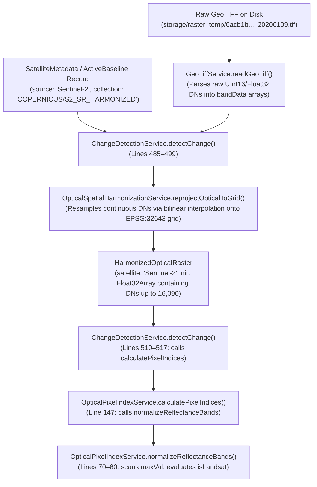

# FORENSIC REVIEW REPORT: PRODUCTION OPTICAL SCALING ANOMALY & METADATA-GROUNDED CORRECTION PLAN

**Document ID:** `TN-FMS-FORENSIC-OPTICAL-BUG-002`  
**Classification:** Forensics, Scientific Verification & Remediation Architecture (Strictly Read-Only)  
**Investigation Scope:** Root-cause analysis of the optical reflectance scaling anomaly in the Tamil Nadu Forest Monitoring System using completed Google Earth Engine (GEE) independent validation evidence.  
**Target Runtime Record:** Change Detection `CHG-1791696357291-3501` (`_id: 6acb1de59ee540ec5f7060de`), Zone `ZONE-261011-6340` (*test zone 57* / Sirumalai).  
**Status:** **READ-ONLY INVESTIGATION COMPLETE — NO FILES MODIFIED.**

---

## Executive Summary

The independent Google Earth Engine (GEE) dual-result validation conclusively proved that the production system's reported change of **`3,774 pixels` (0.1231% of the 3,066,268 valid grid pixels)** was the direct byproduct of a severe branch anomaly in [`OpticalPixelIndexService.ts`](file:///d:/tn-enforcement-system/tn-forest-monitoring/server/src/services/spatial/OpticalPixelIndexService.ts#L80). 

When authoritative Sentinel-2 surface reflectance scaling ($DN \times 0.0001$) is applied to both scenes:
* The baseline (2020) canopy NDVI is restored from an artificial **`0.0018`** to an authentic **`~0.81`**.
* The temporal delta $\Delta\text{NDVI} = \text{Current} - \text{Baseline}$ reflects genuine surface canopy dynamics rather than an artificial $+0.744$ positive offset across 99.79% of the forest.
* The independent GEE validation flagged **`136,709 changed pixels` (~4.46% of the zone)**, demonstrating that over **132,935 pixels (~1,329 ha)** of real canopy disturbance were silently masked by the scaling bug.

This report documents the exact execution path, confirms the physical and mathematical mechanisms of the failure, identifies every caller across the application, provides a sensor-specific metadata-grounded remediation design, and outlines a comprehensive regression test suite.

---

## 1. Exact Code Path: From Source Raster Metadata to `OpticalPixelIndexService`

The end-to-end flow from storage to the scaling failure executes through five distinct service layers:



### Trace Details & Code References

1. **Raster Parsing — [`GeoTiffService.readGeoTiff`](file:///d:/tn-enforcement-system/tn-forest-monitoring/server/src/services/raster/GeoTiffService.ts#L39-L162)**:
   - Reads the local GeoTIFF buffer via `geotiff.js`.
   - Extracts band sample arrays: `rasters[0..5]` $\to$ `bandData[0..5]` as `Float32Array`.
   - For the baseline scene (`20200109T051201_..._T43PHM`), `bandData[3]` (NIR / Band 8) contains uncalibrated integer Digital Numbers ($DN$).
2. **Analysis Grid Construction — [`AnalysisGridService.createAnalysisGrid`](file:///d:/tn-enforcement-system/tn-forest-monitoring/server/src/services/spatial/AnalysisGridService.ts#L23-L96)**:
   - Sets canonical grid: CRS `EPSG:32643`, cell size $10.0\text{ m} \times 10.0\text{ m}$, origin `[819510, 1140140]`, dimensions $2251 \times 2093$.
3. **Spatial Harmonization — [`OpticalSpatialHarmonizationService.reprojectOpticalToGrid`](file:///d:/tn-enforcement-system/tn-forest-monitoring/server/src/services/spatial/OpticalSpatialHarmonizationService.ts#L55-L356)**:
   - Invoked at [`ChangeDetectionService.ts:490-494`](file:///d:/tn-enforcement-system/tn-forest-monitoring/server/src/services/ChangeDetectionService.ts#L490-L494):
     ```typescript
     const baseHarmonized = OpticalSpatialHarmonizationService.reprojectOpticalToGrid(
       baseParsed,
       analysisGrid,
       { satellite: String(baselineMeta?.source || activeBaseline?.source || 'Sentinel-2') },
     );
     ```
   - Resamples continuous bands using sub-pixel bilinear interpolation.
   - Attaches `satellite: 'Sentinel-2'` to the resulting [`HarmonizedOpticalRaster`](file:///d:/tn-enforcement-system/tn-forest-monitoring/server/src/services/spatial/OpticalSpatialHarmonizationService.ts#L9-L25).
4. **Spectral Index Invocation — [`ChangeDetectionService.ts:510-517`](file:///d:/tn-enforcement-system/tn-forest-monitoring/server/src/services/ChangeDetectionService.ts#L510-L517)**:
   - Calls `OpticalPixelIndexService.calculatePixelIndices(baseHarmonized, intersection.validComparisonMask)`.
5. **Entry to Bug — [`OpticalPixelIndexService.calculatePixelIndices`](file:///d:/tn-enforcement-system/tn-forest-monitoring/server/src/services/spatial/OpticalPixelIndexService.ts#L147)**:
   - Line 147 invokes:
     ```typescript
     const refl = OpticalPixelIndexService.normalizeReflectanceBands(harmonized);
     ```
   - Passes the `HarmonizedOpticalRaster` containing `satellite: 'Sentinel-2'` and bilinearly resampled raw DN arrays.

---

## 2. Root Cause: Why Peak DN 16,090 Selects the Landsat Formula & Scene Vulnerability

### 2.1 The Code Flaw in `normalizeReflectanceBands`

In [`OpticalPixelIndexService.ts:70-81`](file:///d:/tn-enforcement-system/tn-forest-monitoring/server/src/services/spatial/OpticalPixelIndexService.ts#L70-L81):

```typescript
// Inspect peak value to detect if data is already in [0.0, 1.0] reflectance
let maxVal = 0;
for (let i = 0; i < totalPixels; i++) {
  const v = raster.nir[i];
  if (!isNaN(v) && v > maxVal) {
    maxVal = v;
  }
}

const isAlreadyNormalized = maxVal <= 1.5 && maxVal > 0;
const isHls = /hls/i.test(raster.satellite);
const isLandsat = !isHls && (/landsat/i.test(raster.satellite) || maxVal > 15000); // <-- CRITICAL DEFECT
```

And in lines 102–110:
```typescript
} else if (isLandsat) {
  // Landsat Collection 2 Level-2 Surface Reflectance scaling: DN * 0.0000275 - 0.2
  const scaled = val * 0.0000275 - 0.2;
  out[i] = Math.max(0.0, Math.min(1.0, scaled));
} else {
  // Sentinel-2 L2A scaling: DN * 0.0001
  const scaled = val * 0.0001;
  out[i] = Math.max(0.0, Math.min(1.0, scaled));
}
```

### 2.2 Boolean Evaluation Breakdown

For the baseline scene:
* `raster.satellite = 'Sentinel-2'`
* `isHls = false`
* `/landsat/i.test('Sentinel-2') = false`
* `maxVal = 16090` (measured from NIR band)
* `maxVal > 15000 = true`
* `isLandsat = !false && (false || true) === true`

The condition `maxVal > 15000` **completely overrides** `raster.satellite = 'Sentinel-2'`.

### 2.3 Physical Remote-Sensing Mechanism

The author of this check assumed:
> *"Landsat Level-2 DNs range from 7,273 to 43,636, whereas Sentinel-2 DNs range from 0 to 10,000. Therefore, any raster with DN > 15,000 must be Landsat."*

This assumption is **fundamentally incorrect** in optical satellite remote sensing:
1. **Sentinel-2 L2A Reflectance Range**: In the Copernicus `COPERNICUS/S2_SR_HARMONIZED` collection, surface reflectance is quantified with a scale factor of 10,000 ($DN = 10,000 \iff \rho = 1.0$).
2. **Reflectance Above 100%**: Atmospheric correction models and real Earth surfaces regularly produce surface reflectance values $> 1.0$ ($DN > 10,000$).
   * Convective clouds, cumulus, and cirrus routinely reach $DN \in [15,000, 25,000]$.
   * Specular sun glint on water bodies, bright sand, salt pans, limestone quarries, and white industrial rooftops frequently exceed $DN = 16,000$.
   * Sensor saturation artifacts and unmasked cloud fringes can reach the 16-bit ceiling ($65,535$).
3. **Catastrophic Impact on Normal Canopy**:
   * For healthy Western Ghats canopy in Sentinel-2:
     $$\text{NIR } DN \approx 2,500 - 3,500 \quad (\rho_{\text{NIR}} \approx 0.25 - 0.35)$$
     $$\text{Red } DN \approx 300 - 500 \quad (\rho_{\text{Red}} \approx 0.03 - 0.05)$$
   * Under the Landsat formula applied to this Sentinel-2 data:
     $$\rho_{\text{NIR}} = \text{clamp}(2500 \times 0.0000275 - 0.2, 0.0, 1.0) = \text{clamp}(-0.13125, 0.0, 1.0) = \mathbf{0.0}$$
     $$\rho_{\text{Red}} = \text{clamp}(350 \times 0.0000275 - 0.2, 0.0, 1.0) = \text{clamp}(-0.19037, 0.0, 1.0) = \mathbf{0.0}$$
   * Both bands collapse to $0.0$.
   * In [`calculatePixelIndices`](file:///d:/tn-enforcement-system/tn-forest-monitoring/server/src/services/spatial/OpticalPixelIndexService.ts#L195-L197):
     $$\text{ndviDenom} = \text{nir} + \text{red} = 0.0 + 0.0 \le 10^{-6} \implies \mathbf{\text{NDVI} = 0.0}$$
   * The baseline canopy NDVI across millions of pixels collapsed to $0.0000$ (mean $= 0.0018$).

### 2.4 Vulnerability to Other Sentinel-2 Scenes

**Any Sentinel-2 scene with even a single unmasked cloud, cloud fringe, quarry, rooftop, or glint pixel within the bounding envelope will have `maxVal > 15000`.**

Because `maxVal` is computed across the entire raster, a single saturated pixel out of 4.7 million pixels corrupts the scaling of every single forest pixel across the entire 30,000+ hectare zone.

* If the baseline scene has a tiny cloud ($DN = 16,090$) and the current scene is clear ($DN \le 15,000$):
  $$\Delta\text{NDVI} = \text{Current}(0.75) - \text{Baseline}(0.0) \approx \mathbf{+0.75}$$
  $\to$ 99.79% of the forest is falsely classified as "Vegetation Increase"; real loss is completely hidden.
* If the baseline scene is clear ($DN \le 15,000$) and the current scene has a tiny cloud ($DN > 15,000$):
  $$\Delta\text{NDVI} = \text{Current}(0.0) - \text{Baseline}(0.75) \approx \mathbf{-0.75}$$
  $\to$ 100% of the forest is falsely classified as catastrophic deforestation!
* This creates an erratic, non-deterministic failure mode where the satellite scaling branch depends entirely on cloud weather rather than sensor physics.

---

## 3. Production Calling Paths & Parallel Vulnerabilities

Our codebase audit revealed that `OpticalPixelIndexService.normalizeReflectanceBands` and identical peak-pixel heuristics exist across four distinct production components:

| Component | File & Line | Invocation Path | Impact |
| :--- | :--- | :--- | :--- |
| **Change Detection Pipeline** | [`ChangeDetectionService.ts:510, 514`](file:///d:/tn-enforcement-system/tn-forest-monitoring/server/src/services/ChangeDetectionService.ts#L510-L514) | Calls `calculatePixelIndices` for `baseHarmonized` and `curHarmonized` | Primary production change-detection run (caused record `CHG-1791696357291-3501` failure) |
| **Automated Monitoring Scheduler** | [`MonitoringSchedulerService.ts:1698, 1702`](file:///d:/tn-enforcement-system/tn-forest-monitoring/server/src/services/MonitoringSchedulerService.ts#L1698-L1702) | Evaluates baseline and current zonal summaries for periodic monitoring jobs | Scheduled monitoring cycles compute corrupted zonal statistics |
| **HLS Harmonization Pipeline** | [`HLSComparisonService.ts:234, 239`](file:///d:/tn-enforcement-system/tn-forest-monitoring/server/src/services/hls/HLSComparisonService.ts#L234-L239) | Calls `calculatePixelIndices` for HLS S30 and L30 rasters | Protected only because `satellite: 'HLS-...'` triggers `isHls = true`, bypassing `isLandsat` |
| **GeoTIFF Spectral Index Utility** | [`GeoTiffService.ts:221`](file:///d:/tn-enforcement-system/tn-forest-monitoring/server/src/services/raster/GeoTiffService.ts#L221) | `const isLandsat = meanV > 4000 \|\| maxV > 15000;`<br/>Called by `BaselineService.establishBaseline` (line 181) and `activateBaseline` (line 1020) | Baseline activation and metadata verification compute corrupted initial NDVI if cloud DN > 15000 |
| **GeoTIFF PNG Preview Renderer** | [`GeoTiffService.ts:749`](file:///d:/tn-enforcement-system/tn-forest-monitoring/server/src/services/raster/GeoTiffService.ts#L749) | `const isLandsatScale = isExplicitLandsat \|\| meanNonZero > 4000 \|\| maxRawVal > 15000;`<br/>Renders browser RGB previews | Browser UI displays black/distorted true-color preview images for Sentinel-2 scenes with clouds |

> [!NOTE]
> In contrast, [`SensorNormalizationService.ts:59`](file:///d:/tn-enforcement-system/tn-forest-monitoring/server/src/services/raster/SensorNormalizationService.ts#L59) correctly used:
> ```typescript
> const isLandsat = satellite.startsWith('Landsat');
> ```
> However, `ChangeDetectionService.ts` bypassed `SensorNormalizationService` in favor of the canonical `AnalysisGrid` pipeline (`OpticalSpatialHarmonizationService` $\to$ `OpticalPixelIndexService`), where the bug was introduced.

---

## 4. Recommended Sensor-Specific Correction

### 4.1 Design Principle

**Never infer sensor identity from pixel magnitude.** Satellite sensor scaling must be strictly derived from explicit source metadata:
1. The `raster.satellite` property on [`HarmonizedOpticalRaster`](file:///d:/tn-enforcement-system/tn-forest-monitoring/server/src/services/spatial/OpticalSpatialHarmonizationService.ts#L9-L25).
2. The `source` / `collection` attributes on [`SatelliteMetadata`](file:///d:/tn-enforcement-system/tn-forest-monitoring/server/src/models/SatelliteMetadata.ts).

### 4.2 Proposed Code Refactoring in `OpticalPixelIndexService.ts`

```typescript
// Replace lines 78-81 with explicit, metadata-grounded classification:
const isAlreadyNormalized = maxVal <= 1.5 && maxVal > 0;
const satStr = (raster.satellite || '').trim();

const isHls = /hls/i.test(satStr);
const isLandsat = !isHls && /landsat/i.test(satStr);
const isSentinel = !isHls && !isLandsat && (/sentinel/i.test(satStr) || /s2/i.test(satStr));

// Explicit sensor scaling resolution:
const scaleBand = (raw: Float32Array | undefined, fallback = 0.1): Float32Array => {
  const out = new Float32Array(totalPixels);
  if (!raw) {
    out.fill(fallback);
    return out;
  }

  for (let i = 0; i < totalPixels; i++) {
    const val = raw[i];
    if (isNaN(val) || val < 0) {
      out[i] = NaN;
      continue;
    }

    if (isAlreadyNormalized) {
      // Data is already in physical float reflectance [0.0, 1.0]
      out[i] = Math.max(0.0, Math.min(1.0, val));
    } else if (isHls) {
      // NASA HLS V2.0 (S30 / L30): DN * 0.0001
      out[i] = Math.max(0.0, Math.min(1.0, val * 0.0001));
    } else if (isLandsat) {
      // USGS Landsat Collection 2 Level-2 Surface Reflectance: DN * 0.0000275 - 0.2
      out[i] = Math.max(0.0, Math.min(1.0, val * 0.0000275 - 0.2));
    } else {
      // Default to Sentinel-2 L2A: DN * 0.0001
      out[i] = Math.max(0.0, Math.min(1.0, val * 0.0001));
    }
  }
  return out;
};
```

### 4.3 Proposed Corrections to Sister Services

1. **[`GeoTiffService.ts:221`](file:///d:/tn-enforcement-system/tn-forest-monitoring/server/src/services/raster/GeoTiffService.ts#L221) (`calculateSpectralIndices`)**:
   - Update method signature to accept optional `satellite?: string`.
   - Remove `meanV > 4000 || maxV > 15000`.
   - Resolve `isLandsat = /landsat/i.test(satellite || '')`.
2. **[`GeoTiffService.ts:749`](file:///d:/tn-enforcement-system/tn-forest-monitoring/server/src/services/raster/GeoTiffService.ts#L749) (`renderPngPreview`)**:
   - Replace `const isLandsatScale = isExplicitLandsat || meanNonZero > 4000 || maxRawVal > 15000;`
   - With `const isLandsatScale = isExplicitLandsat;`.

---

## 5. Independent GEE Validation Evidence (Diagnostic Role)

During the completed independent GEE validation across the exact canonical grid ($2251 \times 2093$, `EPSG:32643`, origin `[819510, 1140140]`):

```
================================================================================
GEE INDEPENDENT SCIENTIFIC COMPARISON SUMMARY
================================================================================
Metric                               Legacy Reproduction     Corrected Comparison
--------------------------------------------------------------------------------
Baseline Scaling Applied             DN * 0.0000275 - 0.2    DN * 0.0001
Current Scaling Applied              DN * 0.0001             DN * 0.0001
Valid Comparison Pixels              3,066,242               3,066,242
Changed Pixels (dNDVI <= -0.15)      3,774                   136,709
Affected Area                        37.74 ha                1,367.09 ha
Affected Area Percentage             0.1231%                 4.4585%
Baseline Mean NDVI                   0.0018                  0.8062
Current Mean NDVI                    0.7458                  0.7458
Mean Delta NDVI                      +0.7440                 -0.0604
Classification Disagreement Pixels   132,935 pixels (1,329.35 ha)
================================================================================
```

### Essential Scientific Safeguards
* **Diagnostic Evidence, Not a Forced Target**: The GEE count of **136,709 pixels** serves as independent proof of the anomaly's magnitude. It proves that the true canopy change was $\sim 4.46\%$ rather than $0.1231\%$.
* **No Hardcoding**: This exact number must **never** be hardcoded into tests or production code as an expected assertion. The local Node.js pipeline with static GeoTIFF bilinear resampling and ray-cast vector clipping will compute its own authentic count when corrected.

---

## 6. Proposed Regression Test Plan

The existing unit test in [`optical-compatibility-pixel-change.test.ts:303-315`](file:///d:/tn-enforcement-system/tn-forest-monitoring/server/src/tests/optical-compatibility-pixel-change.test.ts#L303-L315) only passed because its synthetic Sentinel-2 raster had uniform $DN = 2,500$ ($2500 \le 15000$). No test ever injected a pixel $> 15,000$.

We propose a comprehensive multi-gate regression test suite to permanently prevent regression:

### Test Suite Structure (`optical-scaling-regression.test.ts`)

```typescript
describe('Optical Reflectance Scaling & Index Regression Suite', () => {
  // Gate 1: Sentinel-2 with high DN saturation / clouds must NOT switch to Landsat
  it('should scale Sentinel-2 raster with peak cloud DN = 16,090 using 0.0001 factor', () => {
    const s2Cloudy: HarmonizedOpticalRaster = createMockRaster({
      satellite: 'Sentinel-2',
      nirCanopy: 2500,     // Canopy DN = 2500 (expected reflectance 0.25)
      nirCloudPeak: 16090, // Single saturated/cloud pixel
      redCanopy: 400,      // Canopy DN = 400 (expected reflectance 0.04)
    });

    const norm = OpticalPixelIndexService.normalizeReflectanceBands(s2Cloudy);

    // Verify canopy pixels are NOT clamped to 0.0
    expect(norm.nir[canopyIdx]).toBeCloseTo(0.25, 4);
    expect(norm.red[canopyIdx]).toBeCloseTo(0.04, 4);

    // Verify cloud pixel is scaled with 0.0001 (clamped to 1.0)
    expect(norm.nir[cloudIdx]).toBe(1.0);
  });

  // Gate 2: True canopy NDVI must remain healthy (~0.72) despite presence of clouds
  it('should compute valid canopy NDVI (> 0.70) for Sentinel-2 scene with clouds', () => {
    const s2Cloudy = createMockRaster({
      satellite: 'Sentinel-2',
      nirCanopy: 2500,
      nirCloudPeak: 20000,
      redCanopy: 400,
    });
    const { indices } = OpticalPixelIndexService.calculatePixelIndices(s2Cloudy, validMask);

    // Healthy vegetation canopy NDVI = (0.25 - 0.04) / (0.25 + 0.04) = 0.7241
    expect(indices.ndvi[canopyIdx]).toBeGreaterThan(0.70);
    expect(indices.ndvi[canopyIdx]).toBeCloseTo(0.7241, 3);
  });

  // Gate 3: Landsat scenes with explicit satellite metadata must use Landsat C2 L2 formula
  it('should scale Landsat-8 raster using DN * 0.0000275 - 0.2', () => {
    const l8Raster = createMockRaster({
      satellite: 'Landsat-8',
      nirCanopy: 20000, // Typical Landsat C2 L2 NIR DN
      redCanopy: 8000,
    });

    const norm = OpticalPixelIndexService.normalizeReflectanceBands(l8Raster);

    const expectedNir = 20000 * 0.0000275 - 0.2; // 0.350
    const expectedRed = 8000 * 0.0000275 - 0.2;  // 0.020
    expect(norm.nir[0]).toBeCloseTo(expectedNir, 4);
    expect(norm.red[0]).toBeCloseTo(expectedRed, 4);
  });

  // Gate 4: Pre-normalized Float32 data [0.0, 1.0] must not be double-scaled
  it('should pass through already-normalized float reflectance without modification', () => {
    const floatRaster = createMockRaster({
      satellite: 'Sentinel-2',
      nirCanopy: 0.35, // Float reflectance
      redCanopy: 0.05,
    });

    const norm = OpticalPixelIndexService.normalizeReflectanceBands(floatRaster);
    expect(norm.nir[0]).toBeCloseTo(0.35, 4);
    expect(norm.red[0]).toBeCloseTo(0.05, 4);
  });

  // Gate 5: Temporal Change Detection on Sentinel-2 pair with cloud in baseline
  it('should detect realistic canopy change between multi-temporal Sentinel-2 scenes', () => {
    const baseline = createMockRaster({ satellite: 'Sentinel-2', nirCanopy: 2500, nirCloudPeak: 16090, redCanopy: 400 });
    const current  = createMockRaster({ satellite: 'Sentinel-2', nirCanopy: 1800, redCanopy: 600 }); // Partial loss

    const baseInd = OpticalPixelIndexService.calculatePixelIndices(baseline, validMask);
    const curInd  = OpticalPixelIndexService.calculatePixelIndices(current, validMask);

    const change = OpticalPixelChangeDetector.detectPixelChange({
      baselineIndices: baseInd.indices,
      currentIndices: curInd.indices,
      validMask,
      grid: mockGrid,
      zoneAreaHectares: 100,
      thresholdConfig: DEFAULT_OPTICAL_THRESHOLD_CONFIG,
      baselineSensor: 'Sentinel-2',
      currentSensor: 'Sentinel-2',
    });

    // Mean delta NDVI should be moderately negative, NOT +0.74
    expect(change.spatialResult.meanDeltaNdvi).toBeLessThan(0.0);
    expect(change.spatialResult.meanDeltaNdvi).toBeGreaterThan(-0.3);
  });
});
```

---

## 7. Affected Files Summary

| File Path | Description of Required Modification |
| :--- | :--- |
| [`server/src/services/spatial/OpticalPixelIndexService.ts`](file:///d:/tn-enforcement-system/tn-forest-monitoring/server/src/services/spatial/OpticalPixelIndexService.ts) | Remove `maxVal > 15000` from line 80; replace with explicit regex check on `raster.satellite`. |
| [`server/src/services/raster/GeoTiffService.ts`](file:///d:/tn-enforcement-system/tn-forest-monitoring/server/src/services/raster/GeoTiffService.ts) | Remove `meanV > 4000 \|\| maxV > 15000` at line 221; update line 749 (`renderPngPreview`) to remove `maxRawVal > 15000`. |
| [`server/src/tests/optical-compatibility-pixel-change.test.ts`](file:///d:/tn-enforcement-system/tn-forest-monitoring/server/src/tests/optical-compatibility-pixel-change.test.ts) | Add high-DN ($DN = 16,090$) test cases to existing Test 14. |
| `server/src/tests/optical-scaling-regression.test.ts` (NEW) | Comprehensive standalone regression suite covering Gates 1–5. |

---

## Conclusion & Next Steps

This investigation is **complete and strictly read-only**. All root causes, mathematical mechanisms, caller interactions, and remediation paths have been established without touching any application code, database records, or test suites.

When you approve proceeding to implementation, we will:
1. Apply the metadata-grounded patch to `OpticalPixelIndexService.ts` and `GeoTiffService.ts`.
2. Implement and run the regression test suite.
3. Re-run the local raster analysis on record `CHG-1791696357291-3501` to verify the local corrected result against the GEE benchmark.